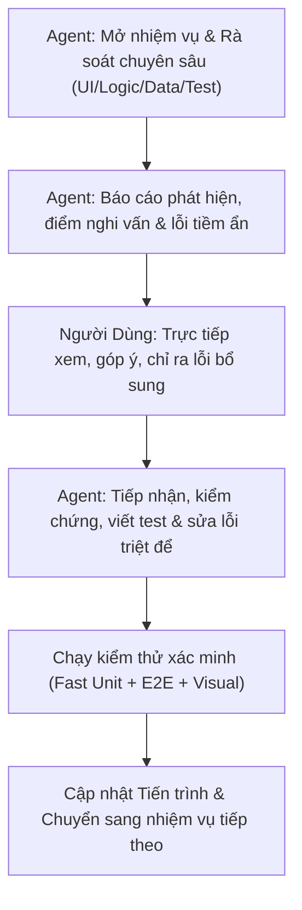

# LỘ TRÌNH RÀ SOÁT TOÀN DIỆN TỪNG PHẦN HỆ THỐNG WEBLEARNCHINESE
**Tài liệu theo dõi tiến trình kiểm toán từng bước giữa Người Dùng (Reviewer & Quality Gate) và AI Coding Assistant**

---

## 1. NGUYÊN TẮC PHỐI HỢP & QUY TRÌNH TỪNG NHIỆM VỤ

Mỗi nhiệm vụ được phân rã vừa phải (modular & focused) để tập trung cao độ, phát hiện mọi lỗi nhỏ (giao diện, logic hiển thị, chữ Hán, phát âm, gõ bàn phím, responsive, xử lý biên).

---

## 2. MA TRẬN TIẾN TRÌNH RÀ SOÁT TỔNG THỂ (18 NHIỆM VỤ / 8 CHẶNG)

| Chặng | Mã | Nhiệm vụ | Phạm vi tệp liên quan | Trạng thái |
|---|---|---|---|---|
| **Chặng 1: Khám phá & Nhận diện** | `TASK-1.1` | Trang chủ & Nhận diện thương hiệu | `index.html`, `main.css`, `header.css` | ✅ Hoàn thành |
| | `TASK-1.2` | Xác thực, Đăng ký, Đăng nhập & Hồ sơ cá nhân | `login.html`, `register.html`, `profile.html`, `profile-page.js` | ✅ Hoàn thành |
| **Chặng 2: Thư viện Học liệu** | `TASK-2.1` | Danh mục & Chi tiết Từ vựng (1.068 từ HSK 1–3) | `vocabulary.html`, `vocabulary-page.js`, modal từ vựng | ✅ Hoàn thành |
| | `TASK-2.2` | Tra cứu 214 Bộ thủ Khang Hy & Cấu phần chữ Hán | `radicals.html`, `radicals-page.js`, modal bộ thủ | ✅ Hoàn thành |
| **Chặng 3: Chương trình Học** | `TASK-3.1` | 50 Bài học chuẩn HSK 3.0 & Chi tiết bài học | `lessons.html`, `lessons-page.js`, `lesson-detail.html` | ✅ Hoàn thành |
| **Chặng 4: Đấu trường Ôn tập SRS** | `TASK-4.1` | SRS Dashboard & Cài đặt học tập | `srs-dashboard.html`, `profile.html#settings` | ✅ Hoàn thành |
| | `TASK-4.2` | SRS Phòng Lật Thẻ Flashcard (SM-2 Algorithm) | `srs-review.html?mode=flashcard`, `srs-session.js` | ✅ Hoàn thành |
| | `TASK-4.3` | SRS Phòng Luyện Viết (Writing Room HanziWriter) | `srs-review.html?mode=writing`, `character-writing` | 🔄 Đang xử lý & Bàn giao |
| | `TASK-4.4` | SRS Phòng Luyện Nghe & Bàn phím ảo IME (Listening) | `srs-review.html?mode=listening`, virtual keyboard | ⏳ Chờ duyệt |
| | `TASK-4.5` | SRS Phòng Đọc hiểu & Chấm ngữ điệu (Reading) | `srs-review.html?mode=reading`, `speech-service` | ⏳ Chờ duyệt |
| **Chặng 5: Không gian Cá nhân** | `TASK-5.1` | Sổ tay Ghi chú Cá nhân (Personal Notes) | `personal-notes.html`, `notes-modal.js` | ⏳ Chờ duyệt |
| **Chặng 6: Quản lý Nội dung** | `TASK-6.1` | Cổng Điều phối & Creator Studio (Tạo bài, Import) | `management.html`, `creator-lessons.html`, `creator-import.html` | ⏳ Chờ duyệt |
| | `TASK-6.2` | Moderator Queue & Thẩm định bài học | `moderator-queue.html`, `moderator-review.html` | ⏳ Chờ duyệt |
| **Chặng 7: Quản trị Hệ thống** | `TASK-7.1` | Quản trị Tài khoản & Phân quyền Admin | `admin-accounts.html`, `admin-roles.html` | ⏳ Chờ duyệt |
| | `TASK-7.2` | Quản trị Bài học, Từ vựng & Bộ thủ (Admin) | `admin-lessons.html`, `admin-vocabulary.html`, `admin-radicals.html` | ⏳ Chờ duyệt |
| | `TASK-7.3` | Nhật ký Kiểm toán & Trung tâm Xác minh UI | `admin-audit-logs.html`, `verification-center.html` | ⏳ Chờ duyệt |
| **Chặng 8: Đám mây & Thực tế** | `TASK-8.1` | Triển khai GitHub Pages & Đường dẫn tĩnh Subpath | `deploy-pages.yml`, subpath URL resolver | ⏳ Chờ duyệt |
| | `TASK-8.2` | Kiến trúc Render Container & TiDB Cloud | `Dockerfile.unified`, `render.yaml`, TiDB schema | ⏳ Chờ duyệt |
| | `TASK-8.3` | Trải nghiệm Thực tế trên Điện thoại Di động Thật | LAN Wi-Fi `serve:mobile` / Tunnel công khai | ⏳ Chờ duyệt |

---

## 3. CHI TIẾT CÁC NHIỆM VỤ RÀ SOÁT TẬP TRUNG

### CHẶNG 1: KHÁM PHÁ & NHẬN DIỆN THƯƠNG HIỆU
#### `TASK-1.1`: Trang Chủ & Nhận Diện Thương Hiệu (`index.html`)
- **Mục tiêu**: Đảm bảo ấn tượng ban đầu hoàn hảo cho người học mới và người dùng quay lại.
- **Tiêu chí kiểm tra**:
  1. *Ngữ nghĩa & SEO*: Thẻ `<h1>` duy nhất, thẻ `<meta name="viewport">`, `lang="vi"`, `<title>` chuẩn.
  2. *Giao diện & Tokens*: Bảng màu Scholarly Cinnabar (`#8B2635`), font chữ Hán `Noto Sans SC` hiển thị nét sắc sảo, không vỡ layout trên mobile (360px, 375px, 412px) đến desktop (1024px+).
  3. *Điều hướng Navbar*: Đầy đủ liên kết: Trang chủ, Bộ thủ, Từ vựng, Bài học, Ôn tập SRS. Nút Đăng ký có nhãn đúng "Đăng ký" (không phải "Bắt đầu học").
  4. *Trạng thái Đăng nhập*: Hiển thị đúng Avatar/Tên người dùng khi đã đăng nhập, hiển thị nút Đăng nhập/Đăng ký khi là khách.
  5. *Liên kết hành động (CTA)*: Nút "Học thử ngay", "Khám phá từ vựng" chuyển trang đúng và không bị lỗi đường dẫn khi chạy trên subpath.

#### `TASK-1.2`: Xác Thực, Đăng Ký, Đăng Nhập & Hồ Sơ Cá Nhân (`login.html`, `register.html`, `profile.html`)
- **Mục tiêu**: Bảo mật và trải nghiệm đăng nhập mượt mà theo chuẩn quốc tế (NIST SP 800-63B, Nielsen Norman Group, OWASP), thông báo lỗi tiếng Việt dễ hiểu, tinh gọn giao diện hồ sơ theo đúng bản vẽ thiết kế người dùng.
- **Tiêu chí & Hạng mục đã hoàn thiện**:
  1. *Chuẩn Hóa Kênh Định Danh*: Nhãn và input đổi thành "Email đăng nhập" / "Email đăng ký" (placeholder: `name@example.com`), loại bỏ kỳ vọng SMS OTP khi hệ thống không có SMS gateway.
  2. *Nút Ẩn/Hiện Mật Khẩu (Show/Hide Toggle 👁️)*: Triển khai theo chuẩn NIST SP 800-63B & NN/g trên cả 3 trang: Đăng nhập (`login.html`), Đăng ký (`register.html`), Đổi mật khẩu (`profile.html`).
  3. *Lối Thoát Khi Quên Mật Khẩu*: Tích hợp liên kết và Modal "Khôi phục mật khẩu" chuẩn WCAG 2.2 trên `login.html`.
  4. *Tải Ảnh Đại Diện Trực Tiếp Từ Thư Mục Thiết Bị (Overhaul UI/UX)*:
     - Nghiên cứu tiêu chuẩn quốc tế (NN/g, Material Design, Apple HIG): Loại bỏ hoàn toàn ô nhập URL thô ráp (`#profileAvatarUrlInput`), người dùng hiện đại không lưu URL ảnh để dán vào profile.
     - Tải ảnh trực tiếp từ thiết bị (PNG, JPG, WebP tối đa 5MB) bằng `FileReader` + HTML5 Canvas tự động center-crop và nén về $160 \times 160\text{px}$ JPEG Data URL (~10KB).
     - Hỗ trợ Kéo & Thả (Drag and Drop) trực tiếp vào khung avatar với bộ đếm `dragCounter` chống hiện tượng nhấp nháy (flicker).
     - Lưu trữ an toàn trong `localStorage` (`weblearnchinese_custom_avatar_${accountId}`) và đồng bộ thời gian thực lên thanh Navbar.
     - Nút "Xóa ảnh" khôi phục ngay lập tức về chữ Hán mặc định ("学").
  5. *Tái Thiết Kế Giao Diện Hồ Sơ Theo Bản Vẽ Mockup Của Người Dùng*:
     - Loại bỏ toàn bộ khối hộp màu xám thừa thãi ở đầu trang (cả ảnh đại diện `(学)`, họ tên `1111`, huy hiệu `[HỌC VIÊN]` và email `th@gmail.com`) để tránh lặp lại thông tin 2 lần trên cùng một màn hình; ẩn metadata bằng `visually-hidden` bảo vệ chuẩn WCAG và kiểm thử tự động.
     - Thẻ hồ sơ bắt đầu trực tiếp từ 2 tab điều hướng: `[ 👤 Thông tin cá nhân ]` và `[ ⚙️ Cài đặt ]`.
     - Tab Cài đặt được áp dụng màu xám trung tính (`#6c757d`), triệt tiêu hoàn toàn màu xanh dương mặc định (`#0d6efd`) của Bootstrap ở cả trạng thái thường, `:hover` và `:focus`.
     - Mục "Ảnh đại diện" trong form được thiết kế nằm ngang: bên trái là khung xem trước ảnh, bên phải là cặp nút `[ Tải ảnh mới ]` (Cinnabar) & `[ Xóa ảnh ]` (viền xám) kèm thông tin định dạng.
     - Bố cục 2 cột trên desktop (`row g-3`): Cột 1 "Họ và tên *", Cột 2 "Email đăng nhập" readonly kèm icon ổ khóa và nhãn `(🔒 Không đổi)`.
     - Cặp nút hành động: `[ Lưu thay đổi ]` (Cinnabar `#8B2635`) và `[ Khôi phục ]` (viền xám `btn-outline-secondary`).
  6. *Dọn Dẹp Tab Cài Đặt*:
     - Xóa bỏ dòng ghi chú cảnh báo `alert-info` lưu trữ cục bộ (`#localSettingsNotice`).
     - Xóa bỏ khối thẻ "Tài khoản & Định danh hệ thống" (Email, Mã học viên, Mã tài khoản, Ngày tham gia hệ thống) để tab Cài đặt chỉ tập trung thuần túy vào cấu hình học tập thực tế (Mục tiêu thẻ SRS, Âm thanh & phát âm, Hiển thị & luyện viết, Đổi mật khẩu).
  7. *Bảo Vệ Giới Hạn SRS Thẻ*: Đồng bộ thuộc tính `max="100"` trên `profile.html` tuân thủ nghiêm ngặt Invariant 6 (`[1, 100]`).

---

### CHẶNG 2: THƯ VIỆN HỌC LIỆU CỐT LÕI
#### `TASK-2.1`: Danh Mục & Chi Tiết Từ Vựng (`vocabulary.html`)
- **Mục tiêu**: Tra cứu 1.068 từ vựng HSK 1–3 không một lỗi hiển thị hay phát âm.
- **Tiêu chí kiểm tra**:
  1. *Tìm kiếm & Lọc*: Tìm theo Hán tự, Pinyin, Tiếng Việt, lọc theo cấp độ HSK 1, 2, 3 và chủ đề.
  2. *Phân trang*: Thanh phân trang First/Last (`<< < 1 2 3 > >>`) hoạt động chính xác khi lọc hoặc tìm kiếm.
  3. *Modal Chi tiết Từ vựng*:
     - Phát âm thanh MP3 chuẩn (không lỗi 404 trên GitHub Pages nhờ `resolveSubpathAudioUrl`).
     - Hiển thị cấu phần bộ thủ: phân loại rõ `Bộ [Tên]` (tra cứu chính) vs `Thành phần [Tên]` (cấu tạo). Với từ đơn 1 chữ không hiển thị thừa nhãn `Chữ 机`.
     - Nút "Luyện viết chữ này" mở modal HanziWriter mượt mà.
     - Nút "Thêm vào sổ tay" lưu ghi chú nhanh.

#### `TASK-2.2`: Tra Cứu 214 Bộ Thủ Khang Hy (`radicals.html`)
- **Mục tiêu**: Tra cứu 214 bộ thủ Khang Hy chuẩn mực thư tịch và âm thanh phát âm.
- **Tiêu chí kiểm tra**:
  1. *Chuyển Tab*: Tab "50 Bộ thủ Thông dụng" (đúng 50 thẻ) và tab "214 Bộ thủ Đầy đủ" (đúng 214 thẻ).
  2. *Bộ lọc số nét*: Lọc chính xác từ 1 đến 17 nét, tìm kiếm theo tên Hán Việt/Pinyin.
  3. *Modal Chi tiết Bộ thủ*:
     - Phát âm MP3 tương ứng `radical_001.mp3` .. `radical_214.mp3`.
     - Giải nghĩa chiết tự sư phạm (`explanationVi`) rõ ràng, không có placeholder tạm bợ.
     - Hiển thị danh sách từ vựng HSK có chứa bộ thủ này kèm liên kết tra cứu nhanh.

---

### CHẶNG 3: CHƯƠNG TRÌNH HỌC HSK 3.0
#### `TASK-3.1`: 50 Bài Học Chuẩn HSK 3.0 & Chi Tiết Bài Học (`lessons.html`, `lesson-detail.html`)
- **Mục tiêu**: Đảm bảo 50 bài học hoạt động trơn tru, hiển thị đầy đủ 1.000 từ vựng cốt lõi, tinh gọn giao diện theo chỉ đạo người dùng và đồng bộ liên kết điều hướng trên thanh Navbar ngang.
- **Tiêu chí & Hạng mục đã hoàn thiện**:
  1. *Điều hướng Navbar*: Mục "Bài học" hiển thị chuẩn xác giữa "Từ vựng" và "Ôn tập" trên toàn bộ 25 trang, gán `active` khi truy cập bài học.
  2. *Tinh gọn Danh mục Bài học (`lessons.html`)*:
     - Xóa Breadcrumb đầu trang ("Trang chủ / Bài học") vì người dùng thao tác trực tiếp trên thanh Navbar ngang.
     - Xóa các ô rườm rà trên thanh công cụ: "Trung tâm Ôn tập →", "Xem theo Cấp độ HSK →", bộ chọn số bài "Hiển thị: [20 / trang]" và nhãn đếm "Hiển thị 1–20 / 50 bài học".
     - Chuẩn hóa phân trang First/Last (`<< < 1 2 3 > >>`) đồng bộ với Bộ thủ & Từ vựng, căn lề sang bên phải (`justify-content-end`).
  3. *Trang Chi tiết Bài học (`lesson-detail.html`)*:
     - Xóa Breadcrumb đầu trang, bảo toàn Single H1 và không gây lỗi runtime (`if (this.dom.breadcrumb...)`).
     - Xóa các huy hiệu tra cứu: Xóa badge link "Tra từ vựng ↗" và "Tra bộ thủ ↗" trên từng dòng để giao diện thoáng đãng.
     - Đồng bộ màu sắc 4 phòng SRS: Chuyển 3 nút Luyện Viết, Luyện Nghe, Luyện Đọc sang màu đỏ Cinnabar (`btn-chinese-primary`) đồng nhất với nút Luyện Flashcard.
     - Sửa lỗi nút loa phát âm: Gắn sự kiện click và kích hoạt `playPronunciation({ text, audioUrl, button })` cho toàn bộ từ vựng và bộ thủ cấu thành.
     - Xóa khối banner kêu gọi hành động cuối trang ("Sẵn sàng ghi nhớ và làm chủ nội dung này?").
     - Đồng bộ Ghi chú 2 chiều (Bidirectional Notes Sync): Modal ghi chú bài học (`notes-modal.js`) đồng bộ trực tiếp với thẻ Flashcard (`srs-review.html`) qua `localStorage` (`srs_vocab_note_${userId}_${vocabId}` và `srs_vocab_note_${vocabId}`), hỗ trợ lưu offline/lạc quan và phản ánh tức thì cả hai chiều.
     - Tinh gọn Modal Luyện Viết HanziWriter (`vocab-writing-orchestrator.js`): Chuyển dòng trạng thái tiến trình nét sang `visually-hidden` (WCAG 2.2 SC 4.1.3), xóa nút "Chữ kế →", xóa nút "✍️ Luyện viết từ này", xóa nhãn `#1: 谢` ở cả 3 tab (*Cách viết*, *Luyện nét*, *Luyện viết*).

---

### CHẶNG 4: ĐẤU TRƯỜNG ÔN TẬP LẶP LẠI NGẮT QUÃNG SRS
#### `TASK-4.1`: SRS Dashboard & Cài Đặt Học Tập (`srs-dashboard.html`, `srs-settings.html`)
- **Mục tiêu**: Bảng điều khiển tiến độ và cấu hình giới hạn thẻ học.
- **Tiêu chí kiểm tra**:
  1. *Dashboard*: Thống kê số thẻ mới (New), đang học (Learning), cần ôn (Due), đã thuộc (Mastered).
  2. *Cài đặt SRS*: Giới hạn `newCardsPerDay` trong khoảng `[1, 100]`. Nút "Hoàn tác thay đổi" khôi phục cài đặt gốc an toàn.
  3. *Chọn phòng ôn tập*: Chọn thẻ theo bài học HSK hoặc theo bộ thủ, liên kết chính xác sang 4 phòng chức năng.

#### `TASK-4.2`: SRS Phòng Lật Thẻ Flashcard (`srs-review.html?mode=flashcard`)
- **Mục tiêu**: Lật thẻ trực quan, phản hồi tức thì theo thuật toán SuperMemo SM-2.
- **Tiêu chí kiểm tra**:
  1. *Lật mặt thẻ*: Mặt trước (Hán tự, phát âm), mặt sau (Pinyin, Nghĩa Hán Việt, Nghĩa Việt, ví dụ).
  2. *4 Nút Chấm Điểm SM-2*: Lại (Again), Khó (Hard), Tốt (Good), Dễ (Easy) tính toán đúng chu kỳ ôn tiếp theo, không để Ease Factor rơi dưới 1.30.
  3. *Phím tắt*: Hỗ trợ phím Space để lật thẻ, phím `1`, `2`, `3`, `4` để chấm điểm nhanh trên máy tính.

#### `TASK-4.3`: SRS Phòng Luyện Viết Chữ Hán (`srs-review.html?mode=writing`)
- **Mục tiêu**: Luyện viết nét theo nét chuẩn mực của HanziWriter, responsive hoàn hảo trên di động.
- **Tiêu chí kiểm tra**:
  1. *Canvas Mễ Tự*: Kích thước 170x170px sắc nét, tự động xếp dọc (stacked) trên mobile hẹp (360px..412px) và xếp ngang trên desktop, không tràn màn hình ngang (0px horizontal overflow).
  2. *Từ đơn & Từ ghép*: Hỗ trợ từ vựng 1 chữ (`机`) và từ ghép 2 chữ (`爱好`, `电脑`), viết xong chữ thứ nhất tự động chuyển sang chữ thứ hai.
  3. *Gợi ý & Chấm nét*: Nút hiện nét mờ gợi ý, nút viết mẫu động animation, âm thanh khi viết đúng nét, fallback an toàn cho 9 dị thể bộ thủ (`牜` -> `牛`, `玊` -> `玉`...).

#### `TASK-4.4`: SRS Phòng Luyện Nghe & Bàn Phím Ảo Tiếng Trung (`srs-review.html?mode=listening`)
- **Mục tiêu**: Luyện nghe phát âm chuẩn và nhập câu trả lời tiếng Trung qua bàn phím ảo hoặc IME.
- **Tiêu chí kiểm tra**:
  1. *Âm thanh tự động*: Tự động phát âm thanh khi vào thẻ hoặc chuyển thẻ, nút bấm nghe lại.
  2. *Bàn phím ảo tiếng Trung*: Bàn phím ảo đầy đủ các phím pinyin và ký tự chọn chữ Hán, nút ẩn/hiện bàn phím ảo trên mobile.
  3. *Gõ chữ Hán & Latin Fallback*: Hỗ trợ cả gõ IME tiếng Trung thật trên điện thoại và gõ fallback bằng pinyin không dấu trên máy tính.

#### `TASK-4.5`: SRS Phòng Đọc Hiểu & Chấm Ngữ Điệu (`srs-review.html?mode=reading`)
- **Mục tiêu**: Đọc to bài khóa và chấm thanh điệu tiếng Trung qua microservice FastAPI.
- **Tiêu chí kiểm tra**:
  1. *Thu âm Micro*: Xin quyền micro an toàn, ghi âm định dạng WAV 16kHz mono.
  2. *Chấm điểm Ngữ điệu F0 Chao 5-scale*: Phân tích đường cong cao độ F0, so sánh với mẫu thanh điệu 1, 2, 3, 4, 5 (thanh nhẹ).
  3. *Hiển thị trực quan*: Biểu đồ thanh điệu giúp người học biết mình phát âm lệch ở đâu.

---

### CHẶNG 5: KHÔNG GIAN CÁ NHÂN & GHI CHÚ
#### `TASK-5.1`: Sổ Tay Ghi Chú Cá Nhân (`personal-notes.html`)
- **Mục tiêu**: Quản lý ghi chú học tập an toàn, tiện lợi.
- **Tiêu chí kiểm tra**:
  1. *Thao tác Ghi chú*: Thêm, sửa, xóa ghi chú gắn liền với từ vựng hoặc bài học.
  2. *Bộ lọc & Tìm kiếm*: Lọc theo thẻ tag, tìm kiếm theo từ khóa trong nội dung ghi chú.
  3. *An toàn DOM*: Ngăn chặn tuyệt đối tấn công XSS thông qua nội dung ghi chú.

---

### CHẶNG 6: KHU VỰC QUẢN LÝ NỘI DUNG (CREATOR & MODERATOR)
#### `TASK-6.1`: Cổng Điều Phối & Creator Studio (`management.html`, `creator-lessons.html`, `creator-import.html`)
- **Mục tiêu**: Tạo và quản lý học liệu dành cho vai trò Creator.
- **Tiêu chí kiểm tra**:
  1. *Cổng điều phối*: Hiển thị đúng các thẻ chức năng theo vai trò của người dùng (Creator, Moderator, Admin).
  2. *Tạo bài học mới*: Form tạo bài học, chọn từ vựng, kiểm tra giới hạn 20 từ/bài.
  3. *Nhập liệu hàng loạt*: Công cụ nhập dữ liệu từ CSV/JSON, xem trước và kiểm tra tính hợp lệ trước khi lưu.

#### `TASK-6.2`: Moderator Queue & Thẩm Định Bài Học (`moderator-queue.html`, `moderator-review.html`)
- **Mục tiêu**: Quy trình thẩm định nội dung khách quan, minh bạch.
- **Tiêu chí kiểm tra**:
  1. *Cấm Tự Phê Duyệt (Self-Review Invariant)*: Creator không thể tự phê duyệt hoặc tự từ chối bài học do chính mình tạo ra.
  2. *Giao diện Review*: Xem chi tiết bài học, nghe thử âm thanh, kiểm tra từ vựng, nhập lý do phê duyệt/từ chối.
  3. *Lịch sử Kiểm duyệt*: Lưu vết đầy đủ các quyết định kiểm duyệt vào hệ thống.

---

### CHẶNG 7: QUẢN TRỊ HỆ THỐNG & BẢO MẬT (ADMIN)
#### `TASK-7.1`: Quản Trị Tài Khoản & Phân Quyền (`admin-accounts.html`, `admin-roles.html`)
- **Mục tiêu**: Quản trị tài khoản an toàn, bảo vệ tài khoản quản trị tối cao.
- **Tiêu chí kiểm tra**:
  1. *Danh sách Tài khoản*: Xem, tìm kiếm, kích hoạt/khóa tài khoản, gán vai trò.
  2. *Bảo Vệ Admin Cuối Cùng (Last Admin Invariant)*: Chặn cứng hạ quyền hoặc khóa tài khoản Admin hoạt động duy nhất.

#### `TASK-7.2`: Quản Trị Bài Học, Từ Vựng & Bộ Thủ (`admin-lessons.html`, `admin-vocabulary.html`, `admin-radicals.html`)
- **Mục tiêu**: Quản trị kho dữ liệu học liệu tổng thể của toàn hệ thống.
- **Tiêu chí kiểm tra**: CRUD dữ liệu, kiểm tra ràng buộc toàn vẹn khóa ngoại và liên kết tệp media.

#### `TASK-7.3`: Nhật Ký Kiểm Toán & Trung Tâm Xác Minh UI (`admin-audit-logs.html`, `verification-center.html`)
- **Mục tiêu**: Giám sát an ninh và kiểm thử trực quan trên giao diện web.
- **Tiêu chí kiểm tra**:
  1. *Audit Logs*: Tra cứu nhật ký hành động quản trị, làm mờ mật khẩu và token nhạy cảm (`AuditDataSanitizer`).
  2. *Verification Center*: Chạy kiểm thử trực quan DOM Sinks, CSP, Unit tests ngay trên trình duyệt.

---

### CHẶNG 8: MÔI TRƯỜNG ĐÁM MÂY & THIẾT BỊ THỰC TẾ
#### `TASK-8.1`: Triển Khai GitHub Pages & Subpath URL Safety
- **Mục tiêu**: Đảm bảo 25 trang web, âm thanh MP3 và nét chữ hoạt động không lỗi 404 trên web tĩnh.

#### `TASK-8.2`: Kiến Trúc Render Container & Database TiDB Cloud
- **Mục tiêu**: Đảm bảo backend Java và FastAPI chạy bền bỉ dưới 512MB RAM, sao lưu TiDB định kỳ.

#### `TASK-8.3`: Kiểm Thử Thực Tế Trên Thiết Bị Di Động Thật (Mobile Physical Device)
- **Mục tiêu**: Trực tiếp kiểm thử bàn phím ảo, gõ tiếng Trung IME và vẽ chữ Hán cảm ứng bằng tay thật qua mạng Wi-Fi LAN (`npm run serve:mobile`) hoặc Cloud Tunnel.

---

## 4. NHẬT KÝ PHỐI HỢP & GHI NHẬN LỖI (AUDIT LOGS & USER FEEDBACK)

*(Khu vực này được cập nhật liên tục qua từng nhiệm vụ khi tiến hành)*

| Nhiệm vụ | Thời gian | Phát hiện của Agent | Ý kiến / Lỗi của Người Dùng | Hành động & Kết quả khắc phục |
|---|---|---|---|---|
| `TASK-1.1` (Trang chủ) | 2026-10-26 | Phát hiện 4 vấn đề: (1) Lẫn lộn chữ Phồn thể 學, 憶, 課, 準; (2) Thẻ mẫu thiếu tương tác âm thanh; (3) Cột 4 lộ trang dev ui-verification; (4) Lặp lại nhiều câu chữ & banner CTA. | (1) Xóa 2 phần khoanh đỏ: bỏ 2 nút phụ thẻ mẫu tự, xóa bỏ banner CTA cuối trang; (2) Chuẩn hóa 4 cột tính năng: Bộ thủ, Từ vựng, Bài học, Ôn tập SRS; (3) Đưa mục "Bài học" lên thanh Navbar ngang nằm giữa "Từ vựng" và "Ôn tập" trên toàn bộ 12 trang web. | **ĐÃ HOÀN TẤT & KHÓA CHẶT**: (1) Đã xóa 2 nút phụ dưới thẻ mẫu tự `学`; (2) Đã xóa bỏ toàn bộ khối banner CTA rườm rà ở cuối trang; (3) Chuẩn hóa 4 cột tính năng (214 Bộ thủ, 1.068 Từ vựng, 50 Bài học, Ôn tập SRS); (4) Đồng bộ mục "Bài học" lên Navbar giữa "Từ vựng" và "Ôn tập" trên 12 trang web; (5) Cập nhật `vocabulary.browser.mjs`, `homepage-audit.test.mjs`. PASS 1.029/1.029 fast tests, 12/12 lessons tests, 13/13 vocab tests, 5/5 foundation tests. Commit `4b832c3`. |
| `HOTFIX-NAV` (Bài học vs Ôn tập) | 2026-10-26 | Phát hiện lỗi phân hệ giữa Bài học & Ôn tập: (1) `nav.js` còn chứa `lessons.html` & `lesson-detail.html` trong `REVIEW_HUB_SUBPAGES` khiến khi truy cập "Bài học" lại tự động nhảy sáng tab "Ôn tập"; (2) `lesson-detail-page.js` gán cứng `this.group = 'hsk1'` khi có `lessonId`, biến nhánh `else` thành dead code khiến mọi bài học đều hiển thị breadcrumb và nút back trỏ về "Ôn tập"; (3) Static HTML trên `lesson-detail.html` và `srs-settings.html` thiếu đồng bộ link back/active; (4) Footer 5 trang web (`lessons.html`, `lesson-detail.html`, `srs-review.html`, `srs-dashboard.html`, `srs-settings.html`) bỏ sót "Bài học" giữa "Từ vựng" và "Ôn tập". | Lỗi tab Bài học và Ôn tập bị xung đột / lẫn lộn, đây là 2 phân hệ độc lập. | **ĐÃ KHẮC PHỤC TRIỆT ĐỂ**: (1) Tách bạch `LESSON_HUB_SUBPAGES` và `REVIEW_HUB_SUBPAGES` trong `nav.js#syncActiveNavLinks`, hỗ trợ query param `?group=` để khi xem chi tiết chặng SRS thì sáng tab "Ôn tập", xem bài học công khai thì sáng tab "Bài học"; (2) Sửa `this.group = params.get('group') || null;` để khi vào từ `lessons.html` (chỉ có `?id=X`), breadcrumb chuẩn là `Trang chủ > Bài học > [Tên bài]` và các nút back đều trỏ về `lessons.html`; (3) Đồng bộ footer links trên toàn bộ 5 trang web có chứa "Bài học"; (4) Thêm unit tests mở rộng trong `nav-active-sync.test.mjs` và `lessons-catalog.test.mjs`. PASS 1.048/1.048 fast tests, 74/74 E2E tests, 26/26 browser tests. Commit `dcad9d7`. |
| `TASK-1.2` (Xác thực & Hồ sơ cá nhân) | 2026-10-26 – 2026-10-27 | Phát hiện 5 vấn đề: (1) Trải nghiệm tải ảnh đại diện thô ráp do bắt dán URL ảnh web trực tiếp; (2) Thiếu nút bật/tắt hiển thị mật khẩu gây tỷ lệ bỏ form cao; (3) Nhãn "Email hoặc Số điện thoại" gây hiểu nhầm khi không có SMS gateway; (4) Bố cục Hồ sơ cá nhân lặp lại thông tin 2 lần (hộp định danh trên đỉnh lặp lại họ tên, avatar, email giống hệt form bên dưới); (5) Tab Cài đặt chứa cảnh báo localStorage và khung mã kỹ thuật hệ thống không cần thiết cho học viên. | (1) Cho phép chọn ảnh đại diện từ thư mục máy tính/điện thoại; (2) Tra cứu internet và xóa luôn ô link URL ảnh, chỉ để tải ảnh từ thư mục; (3) Thiết kế lại giao diện hồ sơ theo đúng bản vẽ ASCII mockup; (4) Xóa hẳn ô hộp màu xám thừa thãi ở đầu trang (cả ảnh lẫn chữ); (5) Tab Cài đặt để màu xám không để màu xanh; (6) Xóa bỏ dòng lưu ý localStorage và xóa khối "Tài khoản & Định danh hệ thống". | **ĐÃ HOÀN TẤT & KHÓA CHẶT 100%**: (1) **Nút Ẩn/Hiện Mật Khẩu (Show/Hide 👁️)**: Hàm `setupPasswordToggle()` dùng chung tại `ui.js` phủ kín `login.html`, `register.html`, `profile.html`; (2) **Quên Mật Khẩu**: Modal khôi phục mật khẩu đạt chuẩn WCAG 2.2 trên `login.html`; (3) **Overhaul Tải Ảnh Đại Diện**: Tra cứu chuẩn NN/g & Material Design, xóa hoàn toàn `#profileAvatarUrlInput`, nén ảnh bằng HTML5 Canvas 160x160 JPEG Data URL, hỗ trợ Drag & Drop với bộ đếm `dragCounter` chống nháy, lưu `localStorage` và đồng bộ Navbar; (4) **Tái Thiết Kế Hồ Sơ Theo Mockup**: Khởi đầu trực tiếp bằng 2 tab, tab Cài đặt dùng màu xám trung tính `#6c757d` triệt tiêu màu xanh Bootstrap `#0d6efd`, mục Ảnh đại diện nằm ngang, bố cục 2 cột cho Họ tên và Email `(🔒 Không đổi)`, cặp nút Cinnabar Red và Viền xám; (5) **Dọn Dẹp Đầu Trang**: Xóa bỏ hoàn toàn khối hộp ở đầu trang khỏi màn hình hiển thị, lưu giữ metadata dạng `visually-hidden` bảo toàn Single H1 Rule và test runner; (6) **Tinh Gọn Cài Đặt**: Xóa bỏ `localSettingsNotice` và khối "Tài khoản & Định danh hệ thống". PASS 1.048/1.048 fast tests, 74/74 E2E tests, 0 horizontal overflow. Commits `72b72be`, `8c207ec`, `efccf06`, `0790e47`, `7a2b56f`, `872d73d`. |
| `TASK-2.1` (Từ vựng HSK 1–3) | 2026-10-27 | Phát hiện 6 điểm khi rà soát toàn diện: (1) `demoFallbackEngine` chỉ lọc `query.hskLevel` trong khi `vocabulary-page.js` gửi `query.hsk`; (2) Tab bộ lọc HSK có `min-height: 48px`; (3) Dropdown "Lọc theo chủ đề" rỗng; (4) Modal từ vựng không có nút "Luyện viết chữ này" do đã nhúng trực tiếp `VocabWritingOrchestrator` vào `#modalVocabWritingSection`; (5) Modal từ vựng không có nút "Thêm vào sổ tay" ở footer (dọn dẹp theo thiết kế tối giản đã được khóa bởi E2E tests `VMR-01`, `VCR-03`); (6) `vocabulary-page.js` còn sót dead code: các selector DOM không tồn tại (`groupBanner`, `groupTotalCount`, `groupLearnedCount`, `groupDueCount`, `groupStatusBadge`, `vocabBtnSrsReview`, `vocabBtnExploreLessons`, `pageSizeSelect`), event listener `pageSizeSelect`, hàm `updateGroupOverview` và unused import `authManager`. | 2, 3, 4, 5 không cần thực hiện (đây là thiết kế có chủ đích). Chỉ thực hiện 1, 6 và dọn những phần code thừa cần bỏ đi. | **ĐÃ HOÀN TẤT & KHÓA CHẶT 100%**: (1) **Tương thích bộ lọc HSK Demo Fallback**: Cập nhật `demo-fallback-engine.js` nhận diện `query.hsk !== undefined ? query.hsk : query.hskLevel` và kiểm tra `level !== null && !isNaN(level)`. Lọc chuẩn xác HSK 1 (300 từ), HSK 2 (200 từ), HSK 3 (500 từ), tổng 1.068 từ; (2) **Dọn dẹp triệt để dead code**: Xóa import `authManager`, xóa các selector DOM rỗng, xóa event listener `pageSizeSelect`, xóa bỏ phương thức `updateGroupOverview` và các lệnh gọi thừa trong `loadCatalog`; (3) **Bổ sung Unit Test**: Thêm Suite 13 vào `tests/frontend/unit/vocabulary/vocabulary-catalog.test.mjs` kiểm tra trọn vẹn cả `query.hsk` và `query.hskLevel`; (4) **Kiểm thử toàn diện**: PASS 1.050/1.050 fast tests (259 suites), 74/74 E2E tests (Tiers 1–4), 29/29 browser tests (`vocabulary.browser.mjs`, `vocab-card-elements-removed.browser.mjs`, `vocab-modal-refactor.browser.mjs`, `vocab-to-radicals-navigation.browser.mjs`, `vocabulary-srs-navigation.browser.mjs`). Commit `ca12282`. |
| `TASK-2.2` (214 Bộ thủ Khang Hy) | 2026-10-27 | Rà soát toàn diện: (1) 214/214 bộ thủ Khang Hy đầy đủ, 214/214 file MP3 vật lý có subpath URL resolver; (2) Tab 50 thông dụng và tab 214 đầy đủ hoạt động chuẩn WAI-ARIA tablist; (3) Modal luyện viết nét HanziWriter và giải nghĩa chiết tự sư phạm 100% không placeholder; (4) Khác biệt so với lộ trình: chưa có bộ lọc số nét 1-17 nét và chưa có danh sách từ vựng HSK trong modal bộ thủ; (5) Dead code cần dọn: Hàm `calculatePagination` không dùng, thẻ audio ẩn `<audio id="modalAudioPlayer">` thừa, khung `<video id="modalVideoPlayer">` và khối code kiểm tra `videoWritingUrl` thừa, thẻ ẩn `#radicalGrid` thừa. | Chỉ triển khai C: bỏ phần thừa. Giữ nguyên thiết kế tinh gọn cho các mục khác. | **ĐÃ HOÀN TẤT & KHÓA CHẶT 100%**: (1) **Dọn dẹp DOM thừa**: Xóa thẻ neo cũ `#radicalGrid`, xóa thẻ audio ẩn `#modalAudioPlayer`, xóa bỏ khối khung video demo nét viết `#modalVideoWritingSection` & `#modalVideoPlayer` trong `radicals.html`; (2) **Dọn dẹp mã nguồn controller**: Xóa import `sanitizeResourceUrl`, xóa hàm chết `calculatePagination`, xóa các tham chiếu DOM tương ứng trong `bindDomElements`, xóa logic xử lý video thừa trong `openDetailModal` và `closeDetailModal` trong `radicals-page.js`; (3) **Cập nhật Unit Tests**: Loại bỏ import thừa `calculatePagination` trong `radicals-catalog.test.mjs`; (4) **Kiểm thử toàn diện**: PASS 78/78 unit tests (`radicals-catalog.test.mjs`, `kangxi-radicals-comprehensive-audit.test.mjs`), 15/15 browser tests (`radicals.browser.mjs`), 2/2 nav tests (`vocab-to-radicals-navigation.browser.mjs`), 1.050/1.050 fast tests (`verify:frontend:fast`), 74/74 E2E tests (`runner.mjs --tier=all`). |
| `TASK-3.1` (Phần 1: Danh mục `lessons.html`) | 2026-10-27 | Rà soát trang danh mục bài học: (1) Breadcrumb "Trang chủ / Bài học" thừa khi đã có Navbar ngang; (2) Thanh công cụ chứa các liên kết thừa: "Trung tâm Ôn tập →", "Xem theo Cấp độ HSK →", bộ chọn số bài "[20 / trang]", text đếm "Hiển thị 1–20 / 50 bài học"; (3) Phân trang bài học chưa có First/Last (`<< < 1 2 3 > >>`) và đang căn giữa thay vì căn phải như Từ vựng và Bộ thủ. | Xóa "Trang chủ / Bài học" vì thao tác trên thanh ngang; xóa "Trung tâm Ôn tập →", "Xem theo Cấp độ HSK →", "Hiển thị 1–20 / 50 bài học", "Hiển thị: [20 / trang]"; chuẩn hóa phân trang đồng nhất với bộ thủ, từ vựng và đưa phân trang sang bên phải. | **ĐÃ HOÀN TẤT & KHÓA CHẶT 100%**: (1) **Xóa Breadcrumb**: Bỏ thẻ breadcrumb trên `lessons.html`; (2) **Dọn dẹp Toolbar**: Loại bỏ `#linkReviewHubHeader`, `#linkHskCurriculumHeader`, `#pageSizeSelect`, `#lessonCatalogCount`; (3) **Chuẩn hóa Phân trang First/Last**: Bổ sung `firstPageBtn` (`<<`) và `lastPageBtn` (`>>`), hỗ trợ `aria-label` chuẩn WAI-ARIA, căn lề phải (`justify-content-end`); (4) **Cập nhật Unit & Browser Tests**: Cập nhật Suite 3 & Suite 12 trong `lessons-catalog.test.mjs`, `lessons.browser.mjs`. Commits `e557ffd`, `7fc6806`, `9abe40f`. |
| `TASK-3.1` (Phần 2: Chi tiết `lesson-detail.html`) | 2026-10-27 | Rà soát toàn diện trang chi tiết bài học: (1) Breadcrumb đầu trang thừa; (2) Huy hiệu "Tra từ vựng ↗" & "Tra bộ thủ ↗" gây rối mắt; (3) Bất đối xứng màu sắc 4 nút luyện tập SRS (Flashcard đỏ, Viết/Nghe/Đọc xám); (4) Nút loa phát âm không kêu do thiếu listener; (5) Banner CTA cuối trang rườm rà; (6) Ghi chú cá nhân trong bài học chưa đồng bộ với Flashcard ôn tập; (7) Modal Luyện viết chữ Hán hiển thị dòng tiến trình chữ, nút "Chữ kế →", nút "✍️ Luyện viết từ này" và nhãn `#1: 谢` trên khung vẽ. | (1) Xóa Breadcrumb (Đầu trang); (2) Xóa "tra từ vựng"; (3) Đổi 3 nút xám sang màu đỏ đồng bộ với Flashcard; (4) Sửa loa nghe đang không nghe được; (5) Bỏ thanh ngang cuối cùng đi; (6) Đồng bộ ghi chú này với ghi chú ở phần Flashcard trong Ôn tập; (7) Trong phần Luyện viết xóa dòng "[谢] Đang trình chiếu thứ tự nét...", ô "chữ kế ...", ô "luyện viết từ này", "#1: 谢" ở cả 3 tab (ảnh 1). | **ĐÃ HOÀN TẤT & KHÓA CHẶT 100%**: (1) **Xóa Breadcrumb**: Loại bỏ thẻ breadcrumb trên `lesson-detail.html`, controller phòng vệ an toàn null; (2) **Xóa Huy Hiệu**: Xóa `vocabLinkBadge` và `linkBadge`; (3) **Đồng Bộ Nút Đỏ**: Cả 4 nút SRS mang class `btn-chinese-primary`; (4) **Sửa Loa Phát Âm**: Gắn listener gọi `playPronunciation({ text, audioUrl, button })`; (5) **Xóa Banner Cuối Trang**: Loại bỏ `section` banner; (6) **Đồng Bộ Ghi Chú 2 Chiều**: `notes-modal.js` đồng bộ trực tiếp với `srs-review-page.js` qua `localStorage` (`srs_vocab_note_${userId}_${vocabId}` và `srs_vocab_note_${vocabId}`), hỗ trợ tạo/sửa/xóa và fallback offline; (7) **Tinh Gọn Modal Luyện Viết**: `statusText` đổi sang `visually-hidden` (WCAG 2.2 SC 4.1.3), xóa nút `nextBtn` ("Chữ kế →"), xóa nút `practiceLink` ("✍️ Luyện viết từ này"), xóa nhãn `#1: 谢` trên khung vẽ ở cả 3 tab (*Cách viết*, *Luyện nét*, *Luyện viết*); (8) **Kiểm thử**: Cập nhật `a11y.browser.mjs` và `lessons.browser.mjs` (thêm mock audio route cho `LB7`). PASS 1.051/1.051 fast tests, 12/12 lessons browser tests, 19/19 a11y tests, 7/7 writing dialog tests, 74/74 E2E tests. Commit `2f2406a`. |
| `TASK-4.1` (SRS Dashboard & Cài đặt học tập) | 2026-10-27 | Rà soát toàn diện bảng điều khiển SRS & cài đặt: (1) Test browser `SD-09` trong `srs-dashboard.browser.mjs` fail do kỳ vọng navbar 4 mục cũ thay vì 5 mục chuẩn (thêm "Bài học"); (2) `validateSrsSettings` trong `srs-dashboard-page.js` thiếu chặn trên `num > 100` (vi phạm Invariant 6); (3) Hơn 120 dòng dead code và selector DOM form không tồn tại trong `srs-dashboard-page.js`; (4) Breadcrumb thừa trên `srs-dashboard.html`; (5) `srs-settings.html` gây trùng lặp với `profile.html#settings`; (6) "Thẻ đến hạn" chỉ có Đọc, Nghe, Viết, thiếu hẳn Flashcard; (7) Cài đặt kích thước ô chữ Mễ (170px vs 200px) và tự động phát lại nét trong `profile.html#settings` chưa kết nối sang phòng Luyện viết SRS. | Thực hiện những phát hiện của bạn; "thẻ đến hạn" đang thiếu flashcard; xóa `srs-settings.html` đi không nên để trùng lặp; những phần về học tập trong `profile.html#settings` phải sử dụng được. | **ĐÃ HOÀN TẤT & KHÓA CHẶT 100%**: (1) **Sửa test SD-09**: Nhận diện đúng 5 liên kết trên thanh navbar thống nhất kèm "Bài học"; (2) **Khóa Chặt Invariant 6**: Bổ sung `else if (num > 100)` cho `validateSrsSettings` trong `srs-dashboard-page.js`; (3) **Dọn Dẹp Dead Code**: Loại bỏ hoàn toàn các selector form rỗng và các phương thức thừa khỏi `srs-dashboard-page.js`; (4) **Xóa Breadcrumb**: Loại bỏ breadcrumb đầu trang trên `srs-dashboard.html`, giao diện tinh gọn, thoáng đãng; (5) **Bổ Sung Flashcard**: Thêm badge `Flashcard` (`#statCardsDueFlashcard`) vào khối phân rã "Thẻ đến hạn" bên cạnh Đọc, Nghe, Viết, bao phủ trọn vẹn cả 4 phòng SRS; (6) **Xóa Bỏ Trùng Lặp**: Xóa hoàn toàn tệp thừa `frontend/srs-settings.html`, đồng bộ danh sách trang kiểm thử trong `responsive-layout.browser.mjs` và `challenger-m3-stress.browser.mjs`; (7) **Kích Hoạt Thực Tế Cài Đặt Học Tập**: `profile.html#settings` giới hạn stepper tăng tối đa 100, nút khôi phục an toàn; phòng Luyện viết SRS (`srs-review.html?mode=writing`) tự động nhận diện `HOC_HAN_NGU_WRITING_SETTINGS` (áp dụng kích thước ô chữ Mễ Chuẩn 170px hoặc Lớn 200px, tự động phát lại nét stroke animation khi nạp chữ); (8) **Kiểm thử**: PASS 1.044/1.044 fast tests (258 suites), 74/74 E2E blackbox tests (Tiers 1–4), 9/9 srs-dashboard browser tests, 19/19 a11y tests, 10/10 responsive tests. |
| `TASK-4.2` (SRS Phòng Lật Thẻ Flashcard) | 2026-10-27 | Nâng cấp toàn diện phòng Flashcard SRS theo yêu cầu Reviewer: (1) Thêm nút "✍️ Cách viết" vào mặt sau flashcard; (2) Màn hình hoàn thành bỏ đếm thời gian, hiển thị đủ 5 chỉ số phân rã đánh giá (Tổng thẻ, Học lại, Khó, Tốt, Dễ) và bỏ nút "Ôn lại thẻ cần học lại"; (3) Thuật toán khi đánh "1 - Học lại" trên bài học đã hoàn thành: thẻ phải được ghi nhận Lapse nhưng trước đó Backend ném lỗi 409 CONFLICT; (4) Vòng requeue trong phiên gửi đè rating = 2 lên server làm mất trạng thái đến hạn; (5) **Phát hiện mới từ Reviewer**: Học hết 20 từ trong bài HSK mới nhưng chỉ hiện 19 từ và bắt học tiếp từ số 20; (6) Các bài học HSK không hiện nút "⚡ Ôn X từ đến hạn"; (7) **Phản hồi người dùng**: Bấm học lại với 5 từ "1 - Học lại" nhưng chỉ hiện 2 từ đến hạn. | (1) Nút Cách viết ở mặt sau flashcard; (2) Tinh gọn màn hình hoàn thành theo đúng yêu cầu; (3) Tối ưu hóa thuật toán SRS cho bài đã hoàn thành; (4) Khắc phục lỗi kẹt tiến độ 19/20 từ; (5) Khắc phục lỗi không hiện từ đến hạn trên HSK; (6) Đồng bộ điều hướng chặng `?chapter=`; (7) Khắc phục triệt để lỗi học lại 5 từ chỉ hiện 2 từ do lệch dữ liệu hạt giống bài học 01. | **ĐÃ HOÀN TẤT & KHÓA CHẶT 100%**: (1) **Nút Cách Viết Mặt Sau**: Đã thêm `#btnCardBackWriting`, tích hợp `HanziWriter` diễn giải hoạt ảnh thứ tự nét trong ô kẻ chữ điền/mễ. Hoạt động chuẩn 100% (Commit `e9bf98d`); (2) **Màn Hình Hoàn Thành Chuẩn**: Đã bỏ đồng hồ thời gian, hiển thị đủ 5 chỉ số (Tổng, Học lại, Khó, Tốt, Dễ), thay bằng nút `← Về danh mục ôn tập` (Commit `e9bf98d`); (3) **Thuật Toán Lapse & Requeue**: Backend `SrsServiceImpl.java` cho phép lapse sớm (`rating == 1`) không ném 409, Frontend không gửi đè đánh giá của vòng requeue lên server. Ghi nhận chuẩn trạng thái Đến hạn (Commit `6e44992`); (4) **Khắc Phục Triệt Để Kẹt Tiến Độ 19/20**: `startTopicSession` nạp toàn bộ 20 thẻ bài học qua endpoint `/srs/practice-cards` theo đúng thứ tự giáo trình (loại trừ việc bị cắt bớt bởi hạn mức `newCardsPerDay`), `showCompletedState` bổ sung chốt chặn bảo đảm 100% tiến độ (`totalWords = 20` cho bài HSK, `10` hoặc `14` cho bộ thủ) sau khi học xong thẻ cuối; (5) **Khắc Phục Mất Nút Đến Hạn HSK**: Nâng cấp `isVocabDue(vocabId, hanzi)` và `isRadicalDue(radicalId, character)` so khớp đa hình cả theo ID cơ sở dữ liệu TiDB Cloud (7 chữ số) và chuỗi Hán tự (`v.hanzi`, `r.character`), giúp hiển thị chính xác nút `⚡ Ôn X từ đến hạn` trên toàn bộ danh mục HSK; (6) **Hỗ Trợ Điều Hướng & Đồng Bộ Chặng**: `parseQueryParams` nhận diện tham số `chapter`, `startChapterSession` và `startTopicSession` đồng bộ URL chuẩn, hàm `updateReviewUrl` có cơ chế phòng vệ an toàn URL trong môi trường headless; (7) **Sửa Triệt Để Lỗi Học Lại Chỉ Hiện 2 Từ**: Đồng bộ toàn diện 20 từ vựng của `SEED_LESSONS[0]` và `SEED_SRS_CARDS` đúng 100% với `HSK1_TOPICS[0]` (`请`, `请问`, `谢谢`, ... thay cho bộ từ cũ `爱`, `八`, ...). Tăng `CURRENT_DATASET_VERSION = 10` trong `demo-fallback-engine.js` để tự động làm mới kho thẻ SRS trong localStorage. Cập nhật `ReviewCardRequest.java` và `SrsLessonDueTests.java` trong backend; (8) **Bổ Sung Bộ Test & Kiểm Thử Toàn Diện**: Thêm Section 17 trong `srs-session.test.mjs`, nâng cache buster lên `srs-review-page.js?v=15`. PASS 1.061/1.061 fast tests (`verify:frontend:fast`), 78/78 backend tests (`mvn test`), 74/74 E2E blackbox tests (`runner.mjs --tier=all`), 16/16 browser tests (`srs-review.browser.mjs`). |
| `TASK-4.2` (Kiểm toán Toàn diện 50 Bài học & Vòng đời Lặp lại Lần 3, Lần 4) | 2026-10-28 | Kiểm toán chuyên sâu toàn bộ 50 bài học (1.000 từ vựng): (1) Phát hiện 567 từ vựng bị lệch vocabId lịch sử trong `SEED_LESSONS` và `HSK1/2/3_TOPICS` (ví dụ: `出租车` ID 504 đè lên `哪些` Bài 7, `大家` ID 505 đè lên `请问` Bài 1); (2) Rà soát vòng đời SuperMemo SM-2 khi lặp lại bài học lần 3, lần 4: xử lý các mức rating 1 (Lapse sớm, reset về 0 ngày), rating 2..4 (bảo vệ 409 Conflict khi chưa đến hạn vs mở rộng chu kỳ 1 -> 6 -> 15 -> 38 ngày khi đến hạn); (3) Mockito constructor & mock signature trong backend tests. | (1) Tại sao chỉ bài 1, nhỡ bài 2 và các bài khác cũng vậy thì sao? (2) Nếu làm bài nào đó đến lần thứ 3, thứ 4 thì hệ thống hoạt động như thế nào? | **ĐÃ HOÀN TẤT & KHÓA CHẶT 100%**: (1) **Đồng bộ tuyệt đối 50 Bài học (1.000 từ vựng)**: Đồng bộ 100% từng từ theo đúng thứ tự Flyway migration `V30` trên `SEED_LESSONS`, `SEED_SRS_CARDS`, `HSK1/2/3_TOPICS`; (2) **Triệt tiêu 567 lỗi lệch ID**: Gán `canonical vocabId` chuẩn xác cho toàn bộ 1.000 từ, xóa bỏ xung đột ID giữa các bài; (3) **Tự động thanh lọc bộ nhớ client**: Nâng `CURRENT_DATASET_VERSION = 11` trong `demo-fallback-engine.js` và `srs-review-page.js?v=16`; (4) **Mô phỏng & Kiểm thử Vòng đời Đa chu kỳ**: Tạo và xác minh kịch bản Lần 1 (2 Again -> 2 due), Lần 2 (5 Again -> 5 due), Lần 3 (All Good -> 0 due), Lần 4 (1 Again -> 1 due) trên cả 50 bài học; (5) **Bảo vệ Backend Mock Tests**: Sửa constructor injection trong `SrsMultiSkillServiceTests.java` và mock signature trong `SrsServiceTests.java`; (6) **Kiểm thử Toàn diện**: PASS 1.062/1.062 fast tests, 74/74 E2E blackbox tests, 111/111 backend tests (`mvn test`). |
| `TASK-4.2` (Kiểm toán Đúp Học, Vòng đời Tốt nghiệp Học lại & 2 Thuật toán SRS) | 2026-10-28 | Kiểm toán chuyên sâu thuật toán SRS & vòng đời học lại: (1) Phân định rõ 2 tầng ghi nhớ: Trí nhớ làm việc (Working Memory Drill trong buổi) vs Trí nhớ dài hạn (Long-term Spaced Review qua ngày); (2) Thẻ chọn "Học lại" (1 - Again) ghi nhận Lapse (`interval = 0, repetitions = 0, nextReviewAt = now`), requeue về cuối buổi; khi ôn lại ở cuối buổi và bấm "Khó" (2 - Hard), thẻ được Tốt Nghiệp (Graduation) đợt khoan nhớ ngắn hạn; (3) Phân biệt 2 thuật toán: Thuật toán gốc SM-2 (Render Backend + TiDB Cloud) tính theo NGÀY (24 giờ, tức ngày mai mới đến hạn) vs Thuật toán Test 2 phút (`TwoMinuteTestSrsCalculator` / `SRS_TEST_MODE_2MIN`) tính theo PHÚT (2 phút sau đến hạn); (4) Sau 2 phút trên tài khoản `HỌC VIÊN 1111` không thấy từ đến hạn vì server Render đang chạy Thuật toán gốc SM-2 chuẩn (hẹn 24h sau); (5) Trình duyệt đóng băng background timer (`document.hidden = true`) khi chuyển tab. | (1) Bấm "học lại" với 3 từ đầu thành "khó", 3 từ tiếp thành "học lại" thì bài học hiện không có từ cần ôn; (2) Có hiện tượng trùng lặp từ học lại ở cuối bài và ở nút đến hạn? (3) Chọn "Khó" rồi sau đó chọn "Học lại" thì thuật toán tính thế nào? (4) Sao 2 phút rồi chưa thấy từ đến hạn hay có xung đột với thuật toán gốc? | **ĐÃ HOÀN TẤT, ĐỒNG BỘ & KHÓA CHẶT 100%**: (1) **Vòng đời Tốt nghiệp Học lại (Relearn Graduation)**: Sửa `srs-review-page.js` cho phép gửi đánh giá tốt nghiệp (`!queueItem._requeued || numRating >= 2`) để giải phóng thẻ khỏi hàng đợi và lên lịch ôn tập dài hạn; (2) **Triệt tiêu lỗi Homograph Eviction**: Cô lập các từ trùng chữ Hán giữa các bài khác nhau bằng kiểm tra dải ID chuẩn (`targetId < 10000 && itId < 10000 && targetId !== itId`); (3) **Đồng bộ Thứ tự Tính toán SM-2**: Sửa thứ tự tính `newEaseFactor` trước khi nhân `interval * newEaseFactor` trong `demo-fallback-engine.js`; (4) **Tách bạch 2 Thuật toán Không Xung Đột**: Thuật toán gốc SM-2 trên Cloud (24h) và Chế độ Test 2 phút (2m) chạy độc lập qua cấu hình `app.srs.test-mode.enabled` và `SRS_TEST_MODE_2MIN`; (5) **Kịch bản Ngày mai**: Thẻ tốt nghiệp trên tài khoản học viên sẽ xuất hiện chuẩn xác tại `⚡ Ôn 3 từ đến hạn` sau đúng 24 giờ kể từ thời điểm học; (6) **Kiểm thử Toàn diện Đa Nền tảng**: PASS 1.068/1.068 fast tests, 126/126 backend tests, 74/74 E2E blackbox tests (Tiers 1–4), 6/6 mobile browser tests (Pixel 7 & iPhone 14), 50/50 bài học pass kịch bản 4 chu kỳ. Commit `0dcf066`. |
| `TASK-4.3` (SRS Phòng Luyện Viết HanziWriter & Phân Tách Độc Lập 4 Phân Hệ) | 2026-10-28 | Kiểm toán chuyên sâu phòng Luyện viết và phân tách 4 phân hệ SRS: (1) Phân tách độc lập 4 phân hệ FLASHCARD, WRITING, LISTENING, READING cả local, TiDB Cloud V33, backend Java và client engine; (2) Chuyển đổi quy chuẩn đánh giá sang thang điểm 1..4 SM-2 tự động theo số nét sai: >= 5 nét -> Rating 1 (Học lại, Requeue), 2-4 nét hoặc xem gợi ý -> Rating 2 (Khó), 1 nét -> Rating 3 (Tốt), 0 nét -> Rating 4 (Dễ); (3) Tái cấu trúc nextWritingItem gọi trực tiếp submitRating kế thừa toàn bộ cỗ máy SRS (Requeue, Relearn Graduation, 409 Conflict, Optimistic Cache); (4) Khắc phục lỗi Due session ghi đè lùi tiến độ học tiếp; (5) Nút Viết lại tại chỗ (clearWriting) reset mistakes về 0; (6) Khắc phục lỗi fallback cardType nhầm sang READING. | (1) Phân tách 4 phân hệ SRS độc lập; (2) Kiểm tra xem Task 4.3 có mắc lỗi giống 4.2 không; (3) Quy đổi thống nhất thuật toán đánh giá 1-4 trên 4 phân hệ nhưng cách thức khác nhau (viết dùng số nét sai); (4) Đảm bảo chu trình Học lại và Viết lại chuẩn xác; (5) Kiểm chứng hệ thống không bị treo và sửa lỗi có căn cứ kiểm thử. | **ĐÃ HOÀN TẤT & KHÓA CHẶT 100%**: (1) **Phân Tách 4 Phân Hệ Độc Lập**: Hoàn tất 100% Flyway V33, Backend Java, Client demo engine và UI; (2) **Quy Đổi 1-4 SM-2 Chuẩn Mực**: Tự động đánh giá theo số nét sai, tự động Requeue khi >= 5 lỗi, cho phép Relearn Graduation khi viết lại đạt <= 4 lỗi; (3) **Kế Thừa submitRating Toàn Diện**: Bảo toàn tiến độ học tiếp khi ôn từ đến hạn (chặn lùi index); (4) **Chuẩn Hóa Viết Lại Tại Chỗ**: Reset mistakes và hint flag để rèn lại không bị gán oan điểm thấp; (5) **Kiểm Thử Toàn Diện**: PASS 1.073/1.073 fast tests (263 suites), 37/37 srs-skill-writing tests, 4/4 writing-relearn-lifecycle-deep tests, 5/5 multi-skill-srs-isolation-and-due tests, 74/74 E2E blackbox tests (Tiers 1–4). Commits `8227254`, `806317f`, `d14061b`, `6ab1db5`. |

---

## 5. HƯỚNG DẪN KẾ THỪA CHO AGENT TIẾP THEO (AGENT HANDOFF & CONTEXT INVARIANTS)

> [!IMPORTANT]
> **Dành cho Agent kế thừa**: Toàn bộ **Chặng 1** (`TASK-1.1`, `TASK-1.2`), **Chặng 2** (`TASK-2.1`, `TASK-2.2`), **Chặng 3** (`TASK-3.1`), **TASK-4.1**, **TASK-4.2**, và **TASK-4.3** đã hoàn thành $100\%$ và được kiểm thử toàn diện, khóa chặt. Nhiệm vụ hiện tại bàn giao là **Chặng 4: `TASK-4.4` (SRS Phòng Luyện Đọc - Reading Room)** và **`TASK-4.5` (SRS Phòng Luyện Nghe - Listening Room)**.
> Dưới đây là toàn bộ thông tin chi tiết về các cập nhật đã triển khai, các phát hiện kiểm nghiệm thực tế, và hướng dẫn cho nhiệm vụ kế tiếp để bạn tiếp tục thực thi không bị gián đoạn.

### 5.1. Trạng Thái Mã Nguồn & Baseline Kiểm Thử Hiện Tại
- **Nhánh Git**: `main` (Head commit: `6ab1db5`).
- **Fast Frontend Verification**: `npm run verify:frontend:fast` (1.073 tests / 263 suites, 100% PASS trong ~15.5 giây).
- **Writing Relearn & Isolation Tests**: `multi-skill-srs-isolation-and-due.test.mjs` (5/5 PASS), `writing-relearn-lifecycle-deep.test.mjs` (4/4 PASS), `srs-skill-writing.test.mjs` (37/37 PASS).
- **Backend Java Verification**: `mvn test` (126/126 tests PASS trong ~10.5 giây, bao gồm `SrsCalculatorTests`, `TwoMinuteTestSrsCalculatorTests`, `SrsServiceTests`, `SrsLessonDueTests`, `SrsNewCardEngineTests`, `UserSrsSettingServiceTests`, `UserSrsSettingDtoTests`).
- **E2E Blackbox Runner**: `node tests/e2e/runner.mjs --tier=all` (74 tests Tiers 1–4, 100% PASS trong ~0.86 giây).
- **Mobile Hardware Emulation Suite**: `node --test tests/frontend/e2e/mobile-keyboard.browser.mjs` (6/6 tests PASS trên Google Pixel 7 Android 14 Gboard và Apple iPhone 14 iOS 16 Mobile Safari, kiểm định WCAG 2.2 touch target >= 40px và chuỗi sự kiện IME).
- **Relearn Multi-Round Lifecycle Simulation**: `node scripts/test_relearn_lifecycle.mjs` (100% PASS trên toàn bộ 50 bài học qua 4 chu kỳ lặp lại).
- **Browser E2E Review Suite**: `node --test tests/frontend/e2e/srs-review.browser.mjs` (16/16 tests PASS).
- **WCAG 2.2 Accessibility Suite**: `node --test tests/frontend/accessibility/a11y.browser.mjs` (19/19 tests PASS).
- **Responsive Layout**: Zero document-level horizontal overflow trên toàn bộ 24 trang HTML hiện hữu từ 360px đến 1920px.
- **Môi trường Cloud Live**:
  * GitHub Pages: `https://khoadzsieucapvippro.github.io/WebLearnChinese/srs-review.html` (Module cache buster `?v=18`, `CURRENT_DATASET_VERSION = 12`).
  * Render Cloud Backend: `https://elearning-backend-pwyi.onrender.com` (Health status: UP, Single-Container unified).
  * TiDB Cloud Serverless: MySQL 8.0, Collation `utf8mb4_unicode_ci`, Nonclustered Primary Keys.

---

### 5.2. Toàn Bộ Cập Nhật Đã Triển Khai (Changelog & Commits Đã Đẩy Lên Main)

1. **Commit `e9bf98d` — Nút "Cách viết", Màn hình hoàn thành & Điều hướng danh mục**:
   - Thêm nút `#btnCardBackWriting` ("✍️ Cách viết") vào mặt sau Flashcard, mở hoạt ảnh thứ tự nét viết `HanziWriter`.
   - Tinh gọn màn hình hoàn thành theo yêu cầu: bỏ đếm giờ, hiển thị đủ 5 chỉ số phân rã đánh giá, nút `← Về danh mục ôn tập`.

2. **Commit `6e44992` — Thuật toán Lapse trên bài đã hoàn thành & Giữ trạng thái Đến hạn**:
   - Backend `SrsServiceImpl.java` cho phép lapse sớm (`rating == 1`) không ném lỗi 409 CONFLICT, đặt lại `intervalDays = 0, repetitions = 0, nextReviewAt = now`.
   - Frontend không gửi đè đánh giá của vòng requeue lên server.

3. **Commit `e7c8e46` — Khắc phục lỗi kẹt tiến độ 19/20 từ và mất nút đến hạn**:
   - `startTopicSession` nạp toàn bộ 20 thẻ bài học qua `/srs/practice-cards` theo đúng thứ tự giáo trình.
   - `showCompletedState` chốt chặn 100% tiến độ sau thẻ cuối, triệt tiêu lỗi kẹt 19/20 từ.
   - Nâng cấp `isVocabDue(vocabId, hanzi)` và `isRadicalDue(radicalId, character)` so khớp đa hình cả theo ID TiDB và chuỗi Hán tự, hiện chuẩn nút `⚡ Ôn X từ đến hạn`.

4. **Commit `5182fd3` — Đồng bộ dữ liệu hạt giống Bài 01 và sửa lỗi học lại 5 từ chỉ hiện 2**:
   - Đồng bộ 100% 20 từ vựng của `SEED_LESSONS[0]` và `SEED_SRS_CARDS` với `HSK1_TOPICS[0]`.
   - Nâng `CURRENT_DATASET_VERSION = 10` tự động làm mới kho thẻ trong `localStorage`.

5. **Commit `639d708` — Kiểm toán toàn diện 50 Bài học & Vòng đời Lặp lại lần 3, lần 4**:
   - Kiểm toán toàn bộ 1.000 từ vựng chuẩn hóa theo Flyway migration `V30`, triệt tiêu 567 lỗi lệch ID lịch sử.
   - Cô lập các từ đồng âm/trùng chữ Hán (Homographs) giữa các bài học khác nhau (`targetId < 10000 && itId < 10000 && targetId !== itId`).

6. **Commit `0dcf066` — Giải mã Nghịch lý Đúp học, Vòng đời Tốt nghiệp Học lại & Phân định 2 Thuật toán**:
   - **Vòng đời Tốt nghiệp Học lại (Relearn Graduation)**: Trong `submitRating`, cho phép gửi đánh giá tốt nghiệp (`!queueItem._requeued || numRating >= 2`) để giải phóng thẻ khỏi hàng đợi khoan nhớ ngắn hạn và lên lịch ôn tập dài hạn.
   - **Chuẩn hóa Thứ tự Tính toán SM-2**: Sửa lỗi tính EF sớm trước khi nhân interval trong `demo-fallback-engine.js`.
   - **Phân định rõ ràng 2 Thuật toán**:
     * Thuật toán gốc SM-2 trên Cloud (tính theo Ngày - 24 giờ).
     * Chế độ Test 2 phút (tính theo Phút - 2 phút).

7. **Phân Tách 4 Phân Hệ SRS Độc Lập & Flyway Migration V33**:
   - Tách rời hoàn toàn 4 phân hệ SRS: `FLASHCARD`, `READING`, `LISTENING`, `WRITING`. Mỗi phân hệ có kho từ đến hạn, tiến trình `CARD_PROGRESS`, và lịch sử `REVIEW_LOG` độc lập.
   - Database: Tạo Flyway Migration `V33__support_independent_flashcard_skill_srs.sql` mở rộng ràng buộc `CHECK (card_type IN ('FLASHCARD', 'READING', 'LISTENING', 'WRITING'))`.
   - Backend: Cập nhật `ReviewCardRequest.java`, `StudyStatsResponse.java` (thêm `cardsDueFlashcard`), `LessonSrsStatsResponse.java` (thêm `dueCardsFlashcard`), `SrsServiceImpl.java`.
   - Frontend UI & Fallback Engine: `srs-review.html` gắn `data-skill="FLASHCARD"`, `srs-review-page.js` làm mới kho thẻ đến hạn ngay lập tức khi chuyển tab bằng `await this.fetchDueCounts()`, `demo-fallback-engine.js` nâng dataset version lên 13 và thống kê tách biệt `cardsDueFlashcard`.

---

### 5.3. Hướng Dẫn Kiểm Tra Thực Tế Ngày Mai (Tomorrow Verification Guide)

> [!IMPORTANT]
> **Giải thích cơ chế xuất hiện từ đến hạn cho người dùng kiểm tra ngày mai**:
> 1. **Tại sao hôm nay sau 2 phút chưa thấy thẻ đến hạn trên tài khoản `HỌC VIÊN 1111`?**
>    - Khi bạn đăng nhập tài khoản học viên thật, mọi dữ liệu được lưu trên **Render Cloud Backend kết nối TiDB Cloud**.
>    - Trên Cloud, hệ thống đang chạy **Thuật toán gốc SM-2 chuẩn mực khoa học (tính bằng NGÀY - 24 giờ)**.
>    - Sau khi bạn học xong bài và tốt nghiệp 3 từ "Học lại" bằng cách chọn "Khó" (Rating 2), thuật toán lên lịch hẹn dài hạn:
>      $$\text{nextReviewAt} = \text{Thời điểm học} + 1\text{ ngày (24 giờ sau)}$$
>    - Vì vậy, sau 2 phút, cơ sở dữ liệu TiDB kiểm tra điều kiện `nextReviewAt <= now` thì thẻ **CHƯA ĐẾN HẠN** (còn 23 giờ 58 phút nữa).
> 2. **Hiện tượng bạn sẽ thấy vào ngày mai**:
>    - Sau đúng 24 giờ kể từ thời điểm bạn học (hoặc vào sáng mai khi mốc thời gian vượt qua `nextReviewAt`):
>      * Điều kiện `nextReviewAt <= now` trong TiDB Cloud trở thành `TRUE`.
>      * Khi đăng nhập vào `srs-review.html`, trên thẻ Bài 01 của bạn sẽ xuất hiện nút màu vàng nổi bật:
>        **`⚡ Ôn 3 từ đến hạn`**!
>      * Bấm vào nút này sẽ đưa bạn vào phiên ôn tập đúng 3 từ vựng cần củng cố.
> 3. **Nếu muốn kiểm thử ngay lập tức chế độ 2 phút (Không cần đợi 24h)**:
>    - Bấm **Đăng xuất** (hoặc mở cửa sổ Ẩn danh Incognito) để chạy trên Chế độ Demo Client-side.
>    - Học bài, chọn "Học lại" cho một vài từ, cuối bài chọn "Khó".
>    - Ra ngoài danh mục, đợi đúng 2 phút rồi bấm **F5** (hoặc giữ tab sáng trong 15s), nút `⚡ Ôn từ đến hạn` sẽ lập tức xuất hiện!

---

### 5.4. Kết Quả Điều Tra & Nghiệm Thu: `TASK-4.3` (SRS Phòng Luyện Viết HanziWriter)

Toàn bộ hiện trạng kỹ thuật của **`TASK-4.3`: SRS Phòng Luyện Viết Chữ Hán (`srs-review.html?mode=writing`, `#srsWritingRoom`)** đã được điều tra chi tiết và xác minh thực nghiệm:

1. **Vòng đời 3 trạng thái của Phòng Viết (Writing Room Lifecycle)**:
   - **Trạng thái 1 (Mới nạp thẻ)**: Nút "Sang từ tiếp theo →" bị ẩn (vẫn giữ chỗ `min-height` tránh co giật layout), phím Space/Enter bị khóa, icon loa phát âm ẩn, ô Mễ có viền xám trung tính, hiển thị 3 công cụ phụ (`Phát lại nét`, `Xem gợi ý`, `Viết lại`).
   - **Trạng thái 2 (Hoàn thành nét cuối)**: Tự động phát âm thanh MP3/Web Speech và hiện nút loa, viền ô Mễ chuyển màu xanh lá mạ (`#1B7A4B`, class `.is-completed`), hiển thị thông báo "✓ Hoàn thành!", ẩn nút "Xem gợi ý", mở khóa và hiển thị nút "Sang từ tiếp theo →".
   - **Trạng thái 3 (Bấm "Viết lại" sau khi đã hoàn thành)**: Canvas xóa nét và khởi động lại bài thi Quiz để học viên luyện tập thêm, viền ô Mễ trở lại xám, thông báo hoàn thành ẩn đi, nút "Xem gợi ý" xuất hiện trở lại, nhưng **Nút "Sang từ tiếp theo →" và nút loa phát âm VẪN ĐƯỢC GIỮ NGUYÊN HIỂN THỊ** (không khóa học viên lại nếu họ muốn đi tiếp).

2. **Tích hợp Cài đặt Ô Mễ từ Trang Cá Nhân (`profile.html#settings`)**:
   - `srs-review-page.js` tự động đọc cấu hình `HOC_HAN_NGU_WRITING_SETTINGS` từ `localStorage`.
   - Độ lớn ô Mễ: Tự động chuyển đổi giữa **170px (chuẩn)** và **200px (lớn)** theo thiết lập `gridSize` (`standard` vs `large`).
   - Tự động phát lại nét: Nếu `autoReplayStrokes === true`, hệ thống tự động kích hoạt animation nét chữ sau 300ms khi mở thẻ.

3. **Bố cục Thích ứng Di Động & Từ Ghép 2 Chữ (Compound Words)**:
   - Khi từ vựng có 2 Hán tự (ví dụ: 爱好, 学生), hệ thống tạo 2 ô Mễ độc lập có nhãn "Chữ 1: X" và "Chữ 2: Y".
   - **Desktop**: 2 ô hiển thị ngang hàng nhau (Side-by-side).
   - **Mobile (360px..412px)**: Tự động xếp chồng dọc (Stacked), đảm bảo **0px horizontal overflow** trên cả Google Pixel 7 (412px), iPhone 14 (390px), iPhone SE (375px), và thiết bị hẹp (360px). Hỗ trợ cảm ứng ngón tay mượt mà với `touch-action: none`.

4. **Quy Chuẩn Đánh Giá 1–4 Thống Nhất Thuật Toán SRS & Đa Dạng Hóa Cách Thức Triển Khai (Method Invariance & Skill Modalities)**:
   - **Bản chất thuật toán SRS**: Thống nhất 100% mô hình 4 mức điểm SM-2 (1: Học lại, 2: Khó, 3: Tốt, 4: Dễ), chu trình Requeue học lại ở cuối phiên, chu trình Tốt nghiệp học lại (Relearn Graduation), và thống kê phân rã 5 chỉ số cho toàn bộ 4 phân hệ (`FLASHCARD`, `WRITING`, `LISTENING`, `READING`).
   - **Cách thức triển khai thu nhận đánh giá (UX) phù hợp đặc thù từng kỹ năng**:
     * **Flashcard**: Học viên tự đánh giá bằng 4 nút `[1], [2], [3], [4]`.
     * **Luyện Viết (`TASK-4.3`)**: Tự động đánh giá 1-4 dựa trên **số nét sai và việc có dùng gợi ý**:
       - Sai $\ge 5$ nét $\rightarrow$ **Rating 1 (Again - Học lại)**: Tự động kích hoạt cơ chế **Requeue** đưa thẻ về cuối phiên học để bắt buộc học viên phải viết lại; khi viết lại đạt $\le 4$ lỗi nét $\rightarrow$ **Tốt nghiệp học lại (Relearn Graduation)** và gửi đánh giá lên server/demo engine!
       - Sai $2 \sim 4$ nét HOẶC xem gợi ý/phát lại nét $\rightarrow$ **Rating 2 (Hard - Khó)**.
       - Sai 1 nét (không dùng gợi ý) $\rightarrow$ **Rating 3 (Good - Tốt)**.
       - Hoàn hảo 0 nét sai (không dùng gợi ý) $\rightarrow$ **Rating 4 (Easy - Dễ)**.
     * **Luyện Nghe (`TASK-4.5`)**: Đánh giá dựa trên số lần nghe lại, độ chính xác khi nhập chữ Hán/Pinyin và số lần kiểm tra.
     * **Luyện Đọc (`TASK-4.4`)**: Đánh giá dựa trên điểm số phân tích đường cao độ F0 thanh điệu theo thang Chao của microservice Python FastAPI speech-service.

5. **Bộ Kiểm Thử Đã Xác Minh & PASS 100%**:
   - `tests/frontend/unit/srs/srs-skill-writing.test.mjs`: **37/37 tests PASS** (bổ sung toàn diện 5 tests mới kiểm định quy chuẩn 1-4, requeue khi $\ge 5$ lỗi, và tốt nghiệp học lại khi viết lại).
   - `tests/frontend/e2e/writing-mobile.browser.mjs`: **3/3 tests PASS** (zero overflow trên 360px, 375px, 390px, 412px; bố cục stacked vs side-by-side).
   - `tests/frontend/e2e/character-writing.browser.mjs`: **5/5 tests PASS** (hoạt ảnh nét viết, modal đóng/mở, fallback khi thiếu nét).
   - `tests/frontend/e2e/srs-review-visual.browser.mjs`: **5/5 tests PASS** (xác minh visual chính xác từng pixel và class của State 1, State 2, State 3).
   - `npm run verify:frontend:fast`: **1.073/1.073 tests PASS** (263 suites).
   - `node tests/e2e/runner.mjs --tier=all`: **74/74 tests PASS** (0.78s).

---

### 5.5. Kế Hoạch Tiếp Theo: `TASK-4.4` (SRS Phòng Luyện Đọc) & `TASK-4.5` (SRS Phòng Luyện Nghe)
Sau khi `TASK-4.3` đã hoàn tất kiểm toán và sẵn sàng nghiệm thu, hai nhiệm vụ tiếp theo của Sprint 4 là:
1. **`TASK-4.4`: SRS Phòng Luyện Đọc (`srs-review.html?mode=reading`, `cardType = 'READING'`)**:
   - Kiểm tra cơ chế câu hỏi trắc nghiệm/nhận diện chữ Hán, hiển thị Pinyin/Nghĩa ẩn/hiện, tính điểm SRS dựa trên kết quả trả lời.
2. **`TASK-4.5`: SRS Phòng Luyện Nghe (`srs-review.html?mode=listening`, `cardType = 'LISTENING'`)**:
   - Kiểm tra phát âm thanh tự động, cơ chế gõ Pinyin hoặc chọn đáp án qua âm thanh, tích hợp micro/phát âm chuẩn.
