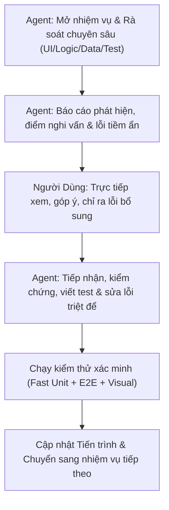

# LỘ TRÌNH RÀ SOÁT TOÀN DIỆN TỪNG PHẦN HỆ THỐNG WEBLEARNCHINESE
**Tài liệu theo dõi tiến trình kiểm toán từng bước giữa Người Dùng (Reviewer & Quality Gate) và AI Coding Assistant**

---

## 1. NGUYÊN TẮC PHỐI HỢP & QUY TRÌNH TỪNG NHIỆM VỤ

Mỗi nhiệm vụ được phân rã vừa phải (modular & focused) để tập trung cao độ, phát hiện mọi lỗi nhỏ (giao diện, logic hiển thị, chữ Hán, phát âm, gõ bàn phím, responsive, xử lý biên).

---

## 2. MA TRẬN TIẾN TRÌNH RÀ SOÁT TỔNG THỂ (18 NHIỆM VỤ / 8 CHẶNG)

| Chặng | Mã | Nhiệm vụ | Phạm vi tệp liên quan | Trạng thái |
|---|---|---|---|---|
| **Chặng 1: Khám phá & Nhận diện** | `TASK-1.1` | Trang chủ & Nhận diện thương hiệu | `index.html`, `main.css`, `header.css` | ✅ Hoàn thành |
| | `TASK-1.2` | Xác thực, Đăng ký, Đăng nhập & Hồ sơ cá nhân | `login.html`, `register.html`, `profile.html`, `auth-state.js` | ✅ Hoàn thành |
| **Chặng 2: Thư viện Học liệu** | `TASK-2.1` | Danh mục & Chi tiết Từ vựng (1.068 từ HSK 1–3) | `vocabulary.html`, `vocabulary-page.js`, modal từ vựng | ⏳ Chờ duyệt |
| | `TASK-2.2` | Tra cứu 214 Bộ thủ Khang Hy & Cấu phần chữ Hán | `radicals.html`, `radicals-page.js`, modal bộ thủ | ⏳ Chờ duyệt |
| **Chặng 3: Chương trình Học** | `TASK-3.1` | 50 Bài học chuẩn HSK 3.0 & Chi tiết bài học | `lessons.html`, `lessons-page.js`, modal luyện viết | ⏳ Chờ duyệt |
| **Chặng 4: Đấu trường Ôn tập SRS** | `TASK-4.1` | SRS Dashboard & Cài đặt học tập | `srs-dashboard.html`, `srs-settings.html` | ⏳ Chờ duyệt |
| | `TASK-4.2` | SRS Phòng Lật Thẻ Flashcard (SM-2 Algorithm) | `srs-review.html?mode=flashcard`, `srs-session.js` | ⏳ Chờ duyệt |
| | `TASK-4.3` | SRS Phòng Luyện Viết (Writing Room HanziWriter) | `srs-review.html?mode=writing`, `character-writing` | ⏳ Chờ duyệt |
| | `TASK-4.4` | SRS Phòng Luyện Nghe & Bàn phím ảo IME (Listening) | `srs-review.html?mode=listening`, virtual keyboard | ⏳ Chờ duyệt |
| | `TASK-4.5` | SRS Phòng Đọc hiểu & Chấm ngữ điệu (Reading) | `srs-review.html?mode=reading`, `speech-service` | ⏳ Chờ duyệt |
| **Chặng 5: Không gian Cá nhân** | `TASK-5.1` | Sổ tay Ghi chú Cá nhân (Personal Notes) | `personal-notes.html`, `notes-modal.js` | ⏳ Chờ duyệt |
| **Chặng 6: Quản lý Nội dung** | `TASK-6.1` | Cổng Điều phối & Creator Studio (Tạo bài, Import) | `management.html`, `creator-lessons.html`, `creator-import.html` | ⏳ Chờ duyệt |
| | `TASK-6.2` | Moderator Queue & Thẩm định bài học | `moderator-queue.html`, `moderator-review.html` | ⏳ Chờ duyệt |
| **Chặng 7: Quản trị Hệ thống** | `TASK-7.1` | Quản trị Tài khoản & Phân quyền Admin | `admin-accounts.html`, `admin-roles.html` | ⏳ Chờ duyệt |
| | `TASK-7.2` | Quản trị Bài học, Từ vựng & Bộ thủ (Admin) | `admin-lessons.html`, `admin-vocabulary.html`, `admin-radicals.html` | ⏳ Chờ duyệt |
| | `TASK-7.3` | Nhật ký Kiểm toán & Trung tâm Xác minh UI | `admin-audit-logs.html`, `verification-center.html` | ⏳ Chờ duyệt |
| **Chặng 8: Đám mây & Thực tế** | `TASK-8.1` | Triển khai GitHub Pages & Đường dẫn tĩnh Subpath | `deploy-pages.yml`, subpath URL resolver | ⏳ Chờ duyệt |
| | `TASK-8.2` | Kiến trúc Render Container & TiDB Cloud | `Dockerfile.unified`, `render.yaml`, TiDB schema | ⏳ Chờ duyệt |
| | `TASK-8.3` | Trải nghiệm Thực tế trên Điện thoại Di động Thật | LAN Wi-Fi `serve:mobile` / Tunnel công khai | ⏳ Chờ duyệt |

---

## 3. CHI TIẾT CÁC NHIỆM VỤ RÀ SOÁT TẬP TRUNG

### CHẶNG 1: KHÁM PHÁ & NHẬN DIỆN THƯƠNG HIỆU
#### `TASK-1.1`: Trang Chủ & Nhận Diện Thương Hiệu (`index.html`)
- **Mục tiêu**: Đảm bảo ấn tượng ban đầu hoàn hảo cho người học mới và người dùng quay lại.
- **Tiêu chí kiểm tra**:
  1. *Ngữ nghĩa & SEO*: Thẻ `<h1>` duy nhất, thẻ `<meta name="viewport">`, `lang="vi"`, `<title>` chuẩn.
  2. *Giao diện & Tokens*: Bảng màu Scholarly Cinnabar (`#8B2635`), font chữ Hán `Noto Sans SC` hiển thị nét sắc sảo, không vỡ layout trên mobile (360px, 375px, 412px) đến desktop (1024px+).
  3. *Điều hướng Navbar*: Đầy đủ liên kết: Trang chủ, Bài học, Từ vựng, Bộ thủ, Ôn tập SRS. Nút Đăng ký có nhãn đúng "Đăng ký" (không phải "Bắt đầu học").
  4. *Trạng thái Đăng nhập*: Hiển thị đúng Avatar/Tên người dùng khi đã đăng nhập, hiển thị nút Đăng nhập/Đăng ký khi là khách.
  5. *Liên kết hành động (CTA)*: Nút "Học thử ngay", "Khám phá từ vựng" chuyển trang đúng và không bị lỗi đường dẫn khi chạy trên subpath.

#### `TASK-1.2`: Xác Thực, Đăng Ký, Đăng Nhập & Hồ Sơ Cá Nhân (`login.html`, `register.html`, `profile.html`)
- **Mục tiêu**: Bảo mật và trải nghiệm đăng nhập mượt mà theo chuẩn quốc tế (NIST SP 800-63B, Nielsen Norman Group, OWASP), thông báo lỗi tiếng Việt dễ hiểu.
- **Tiêu chí & Hạng mục đã hoàn thiện**:
  1. *Chuẩn Hóa Kênh Định Danh*: Nhãn và input đổi thành "Email đăng nhập" / "Email đăng ký" (placeholder: `name@example.com`), loại bỏ kỳ vọng SMS OTP khi hệ thống không có SMS gateway.
  2. *Nút Ẩn/Hiện Mật Khẩu (Show/Hide Toggle 👁️)*: Triển khai theo chuẩn NIST SP 800-63B & NN/g trên cả 3 trang: Đăng nhập (`login.html`), Đăng ký (`register.html`), Đổi mật khẩu (`profile.html`).
  3. *Lối Thoát Khi Quên Mật Khẩu*: Tích hợp liên kết và Modal "Khôi phục mật khẩu" chuẩn WCAG 2.2 trên `login.html`.
  4. *Tải Ảnh Đại Diện Từ Thư Mục Thiết Bị*: Bổ sung nút chọn ảnh từ máy (`FileReader` + tự động crop/resize 160x160 qua HTML5 canvas chống tràn bộ nhớ và bảo mật EXIF), nút xóa ảnh đại diện, đồng bộ hiển thị ảnh avatar trên cả thanh Navbar và trang Hồ sơ.
  5. *Bảo Vệ Giới Hạn SRS Thẻ*: Đồng bộ thuộc tính `max="100"` trên `profile.html` tuân thủ nghiêm ngặt Invariant 6 (`[1, 100]`).

---

### CHẶNG 2: THƯ VIỆN HỌC LIỆU CỐT LÕI
#### `TASK-2.1`: Danh Mục & Chi Tiết Từ Vựng (`vocabulary.html`)
- **Mục tiêu**: Tra cứu 1.068 từ vựng HSK 1–3 không một lỗi hiển thị hay phát âm.
- **Tiêu chí kiểm tra**:
  1. *Tìm kiếm & Lọc*: Tìm theo Hán tự, Pinyin, Tiếng Việt, lọc theo cấp độ HSK 1, 2, 3 và chủ đề.
  2. *Phân trang*: Thanh phân trang First/Last (`<< < 1 2 3 > >>`) hoạt động chính xác khi lọc hoặc tìm kiếm.
  3. *Modal Chi tiết Từ vựng*:
     - Phát âm thanh MP3 chuẩn (không lỗi 404 trên GitHub Pages nhờ `resolveSubpathAudioUrl`).
     - Hiển thị cấu phần bộ thủ: phân loại rõ `Bộ [Tên]` (tra cứu chính) vs `Thành phần [Tên]` (cấu tạo). Với từ đơn 1 chữ không hiển thị thừa nhãn `Chữ 机`.
     - Nút "Luyện viết chữ này" mở modal HanziWriter mượt mà.
     - Nút "Thêm vào sổ tay" lưu ghi chú nhanh.

#### `TASK-2.2`: Tra Cứu 214 Bộ Thủ Khang Hy (`radicals.html`)
- **Mục tiêu**: Tra cứu 214 bộ thủ Khang Hy chuẩn mực thư tịch và âm thanh phát âm.
- **Tiêu chí kiểm tra**:
  1. *Chuyển Tab*: Tab "50 Bộ thủ Thông dụng" (đúng 50 thẻ) và tab "214 Bộ thủ Đầy đủ" (đúng 214 thẻ).
  2. *Bộ lọc số nét*: Lọc chính xác từ 1 đến 17 nét, tìm kiếm theo tên Hán Việt/Pinyin.
  3. *Modal Chi tiết Bộ thủ*:
     - Phát âm MP3 tương ứng `radical_001.mp3` .. `radical_214.mp3`.
     - Giải nghĩa chiết tự sư phạm (`explanationVi`) rõ ràng, không có placeholder tạm bợ.
     - Hiển thị danh sách từ vựng HSK có chứa bộ thủ này kèm liên kết tra cứu nhanh.

---

### CHẶNG 3: CHƯƠNG TRÌNH HỌC HSK 3.0
#### `TASK-3.1`: 50 Bài Học Chuẩn HSK 3.0 & Chi Tiết Bài Học (`lessons.html`, `lesson-detail.html`)
- **Mục tiêu**: Đảm bảo 50 bài học hoạt động trơn tru, hiển thị đầy đủ 1.000 từ vựng và đồng bộ liên kết điều hướng trên thanh Navbar ngang.
- **Tiêu chí kiểm tra**:
  1. *Điều hướng Navbar*: Đảm bảo mục "Bài học" hiển thị chuẩn xác ở vị trí giữa "Từ vựng" và "Ôn tập" trên tất cả các trang, gán `active` khi đang ở trang bài học.
  2. *Danh sách 50 bài học*: HSK 1 (15 bài), HSK 2 (10 bài), HSK 3 (25 bài). Tiến độ học tập (%) hiển thị đúng theo từng người dùng.
  3. *Trang Chi tiết Bài học (`lesson-detail.html`)*:
     - Đầy đủ 20 từ vựng cốt lõi của bài học kèm phát âm, Hán tự, Pinyin, nghĩa tiếng Việt chuẩn xác.
     - Nút luyện viết HanziWriter nhanh trên từng dòng từ vựng (`.lesson-vocab-writing-btn`).
     - Cầu nối sang Ôn tập: Nút "Bắt đầu ôn tập bài học này qua SRS" dẫn trực tiếp vào phòng ôn tập tương ứng.

---

### CHẶNG 4: ĐẤU TRƯỜNG ÔN TẬP LẶP LẠI NGẮT QUÃNG SRS
#### `TASK-4.1`: SRS Dashboard & Cài Đặt Học Tập (`srs-dashboard.html`, `srs-settings.html`)
- **Mục tiêu**: Bảng điều khiển tiến độ và cấu hình giới hạn thẻ học.
- **Tiêu chí kiểm tra**:
  1. *Dashboard*: Thống kê số thẻ mới (New), đang học (Learning), cần ôn (Due), đã thuộc (Mastered).
  2. *Cài đặt SRS*: Giới hạn `newCardsPerDay` trong khoảng `[1, 100]`. Nút "Hoàn tác thay đổi" khôi phục cài đặt gốc an toàn.
  3. *Chọn phòng ôn tập*: Chọn thẻ theo bài học HSK hoặc theo bộ thủ, liên kết chính xác sang 4 phòng chức năng.

#### `TASK-4.2`: SRS Phòng Lật Thẻ Flashcard (`srs-review.html?mode=flashcard`)
- **Mục tiêu**: Lật thẻ trực quan, phản hồi tức thì theo thuật toán SuperMemo SM-2.
- **Tiêu chí kiểm tra**:
  1. *Lật mặt thẻ*: Mặt trước (Hán tự, phát âm), mặt sau (Pinyin, Nghĩa Hán Việt, Nghĩa Việt, ví dụ).
  2. *4 Nút Chấm Điểm SM-2*: Lại (Again), Khó (Hard), Tốt (Good), Dễ (Easy) tính toán đúng chu kỳ ôn tiếp theo, không để Ease Factor rơi dưới 1.30.
  3. *Phím tắt*: Hỗ trợ phím Space để lật thẻ, phím `1`, `2`, `3`, `4` để chấm điểm nhanh trên máy tính.

#### `TASK-4.3`: SRS Phòng Luyện Viết Chữ Hán (`srs-review.html?mode=writing`)
- **Mục tiêu**: Luyện viết nét theo nét chuẩn mực của HanziWriter, responsive hoàn hảo trên di động.
- **Tiêu chí kiểm tra**:
  1. *Canvas Mễ Tự*: Kích thước 170x170px sắc nét, tự động xếp dọc (stacked) trên mobile hẹp (360px..412px) và xếp ngang trên desktop, không tràn màn hình ngang (0px horizontal overflow).
  2. *Từ đơn & Từ ghép*: Hỗ trợ từ vựng 1 chữ (`机`) và từ ghép 2 chữ (`爱好`, `电脑`), viết xong chữ thứ nhất tự động chuyển sang chữ thứ hai.
  3. *Gợi ý & Chấm nét*: Nút hiện nét mờ gợi ý, nút viết mẫu động animation, âm thanh khi viết đúng nét, fallback an toàn cho 9 dị thể bộ thủ (`牜` -> `牛`, `玊` -> `玉`...).

#### `TASK-4.4`: SRS Phòng Luyện Nghe & Bàn Phím Ảo Tiếng Trung (`srs-review.html?mode=listening`)
- **Mục tiêu**: Luyện nghe phát âm chuẩn và nhập câu trả lời tiếng Trung qua bàn phím ảo hoặc IME.
- **Tiêu chí kiểm tra**:
  1. *Âm thanh tự động*: Tự động phát âm thanh khi vào thẻ hoặc chuyển thẻ, nút bấm nghe lại.
  2. *Bàn phím ảo tiếng Trung*: Bàn phím ảo đầy đủ các phím pinyin và ký tự chọn chữ Hán, nút ẩn/hiện bàn phím ảo trên mobile.
  3. *Gõ chữ Hán & Latin Fallback*: Hỗ trợ cả gõ IME tiếng Trung thật trên điện thoại và gõ fallback bằng pinyin không dấu trên máy tính.

#### `TASK-4.5`: SRS Phòng Đọc Hiểu & Chấm Ngữ Điệu (`srs-review.html?mode=reading`)
- **Mục tiêu**: Đọc to bài khóa và chấm thanh điệu tiếng Trung qua microservice FastAPI.
- **Tiêu chí kiểm tra**:
  1. *Thu âm Micro*: Xin quyền micro an toàn, ghi âm định dạng WAV 16kHz mono.
  2. *Chấm điểm Ngữ điệu F0 Chao 5-scale*: Phân tích đường cong cao độ F0, so sánh với mẫu thanh điệu 1, 2, 3, 4, 5 (thanh nhẹ).
  3. *Hiển thị trực quan*: Biểu đồ thanh điệu giúp người học biết mình phát âm lệch ở đâu.

---

### CHẶNG 5: KHÔNG GIAN CÁ NHÂN & GHI CHÚ
#### `TASK-5.1`: Sổ Tay Ghi Chú Cá Nhân (`personal-notes.html`)
- **Mục tiêu**: Quản lý ghi chú học tập an toàn, tiện lợi.
- **Tiêu chí kiểm tra**:
  1. *Thao tác Ghi chú*: Thêm, sửa, xóa ghi chú gắn liền với từ vựng hoặc bài học.
  2. *Bộ lọc & Tìm kiếm*: Lọc theo thẻ tag, tìm kiếm theo từ khóa trong nội dung ghi chú.
  3. *An toàn DOM*: Ngăn chặn tuyệt đối tấn công XSS thông qua nội dung ghi chú.

---

### CHẶNG 6: KHU VỰC QUẢN LÝ NỘI DUNG (CREATOR & MODERATOR)
#### `TASK-6.1`: Cổng Điều Phối & Creator Studio (`management.html`, `creator-lessons.html`, `creator-import.html`)
- **Mục tiêu**: Tạo và quản lý học liệu dành cho vai trò Creator.
- **Tiêu chí kiểm tra**:
  1. *Cổng điều phối*: Hiển thị đúng các thẻ chức năng theo vai trò của người dùng (Creator, Moderator, Admin).
  2. *Tạo bài học mới*: Form tạo bài học, chọn từ vựng, kiểm tra giới hạn 20 từ/bài.
  3. *Nhập liệu hàng loạt*: Công cụ nhập dữ liệu từ CSV/JSON, xem trước và kiểm tra tính hợp lệ trước khi lưu.

#### `TASK-6.2`: Moderator Queue & Thẩm Định Bài Học (`moderator-queue.html`, `moderator-review.html`)
- **Mục tiêu**: Quy trình thẩm định nội dung khách quan, minh bạch.
- **Tiêu chí kiểm tra**:
  1. *Cấm Tự Phê Duyệt (Self-Review Invariant)*: Creator không thể tự phê duyệt hoặc tự từ chối bài học do chính mình tạo ra.
  2. *Giao diện Review*: Xem chi tiết bài học, nghe thử âm thanh, kiểm tra từ vựng, nhập lý do phê duyệt/từ chối.
  3. *Lịch sử Kiểm duyệt*: Lưu vết đầy đủ các quyết định kiểm duyệt vào hệ thống.

---

### CHẶNG 7: QUẢN TRỊ HỆ THỐNG & BẢO MẬT (ADMIN)
#### `TASK-7.1`: Quản Trị Tài Khoản & Phân Quyền (`admin-accounts.html`, `admin-roles.html`)
- **Mục tiêu**: Quản trị tài khoản an toàn, bảo vệ tài khoản quản trị tối cao.
- **Tiêu chí kiểm tra**:
  1. *Danh sách Tài khoản*: Xem, tìm kiếm, kích hoạt/khóa tài khoản, gán vai trò.
  2. *Bảo Vệ Admin Cuối Cùng (Last Admin Invariant)*: Chặn cứng hạ quyền hoặc khóa tài khoản Admin hoạt động duy nhất.

#### `TASK-7.2`: Quản Trị Bài Học, Từ Vựng & Bộ Thủ (`admin-lessons.html`, `admin-vocabulary.html`, `admin-radicals.html`)
- **Mục tiêu**: Quản trị kho dữ liệu học liệu tổng thể của toàn hệ thống.
- **Tiêu chí kiểm tra**: CRUD dữ liệu, kiểm tra ràng buộc toàn vẹn khóa ngoại và liên kết tệp media.

#### `TASK-7.3`: Nhật Ký Kiểm Toán & Trung Tâm Xác Minh UI (`admin-audit-logs.html`, `verification-center.html`)
- **Mục tiêu**: Giám sát an ninh và kiểm thử trực quan trên giao diện web.
- **Tiêu chí kiểm tra**:
  1. *Audit Logs*: Tra cứu nhật ký hành động quản trị, làm mờ mật khẩu và token nhạy cảm (`AuditDataSanitizer`).
  2. *Verification Center*: Chạy kiểm thử trực quan DOM Sinks, CSP, Unit tests ngay trên trình duyệt.

---

### CHẶNG 8: MÔI TRƯỜNG ĐÁM MÂY & THIẾT BỊ THỰC TẾ
#### `TASK-8.1`: Triển Khai GitHub Pages & Subpath URL Safety
- **Mục tiêu**: Đảm bảo 25 trang web, âm thanh MP3 và nét chữ hoạt động không lỗi 404 trên web tĩnh.

#### `TASK-8.2`: Kiến Trúc Render Container & Database TiDB Cloud
- **Mục tiêu**: Đảm bảo backend Java và FastAPI chạy bền bỉ dưới 512MB RAM, sao lưu TiDB định kỳ.

#### `TASK-8.3`: Kiểm Thử Thực Tế Trên Thiết Bị Di Động Thật (Mobile Physical Device)
- **Mục tiêu**: Trực tiếp kiểm thử bàn phím ảo, gõ tiếng Trung IME và vẽ chữ Hán cảm ứng bằng tay thật qua mạng Wi-Fi LAN (`npm run serve:mobile`) hoặc Cloud Tunnel.

---

## 4. NHẬT KÝ PHỐI HỢP & GHI NHẬN LỖI (AUDIT LOGS & USER FEEDBACK)

*(Khu vực này sẽ được cập nhật liên tục qua từng nhiệm vụ khi tiến hành)*

| Nhiệm vụ | Thời gian | Phát hiện của Agent | Ý kiến / Lỗi của Người Dùng | Hành động & Kết quả khắc phục |
|---|---|---|---|---|
| `TASK-1.1` (Trang chủ) | 2026-10-26 | Phát hiện 4 vấn đề: (1) Lẫn lộn chữ Phồn thể 學, 憶, 課, 準; (2) Thẻ mẫu thiếu tương tác âm thanh; (3) Cột 4 lộ trang dev ui-verification; (4) Lặp lại nhiều câu chữ & banner CTA. | (1) Xóa 2 phần khoanh đỏ: bỏ 2 nút phụ thẻ mẫu tự, xóa bỏ banner CTA cuối trang; (2) Chuẩn hóa 4 cột tính năng: Bộ thủ, Từ vựng, Bài học, Ôn tập SRS; (3) Đưa mục "Bài học" lên thanh Navbar ngang nằm giữa "Từ vựng" và "Ôn tập" trên toàn bộ 12 trang web. | **ĐÃ HOÀN TẤT & KHÓA CHẶT**: (1) Đã xóa 2 nút phụ dưới thẻ mẫu tự `学`; (2) Đã xóa bỏ toàn bộ khối banner CTA rườm rà ở cuối trang; (3) Chuẩn hóa 4 cột tính năng (214 Bộ thủ, 1.068 Từ vựng, 50 Bài học, Ôn tập SRS); (4) Đồng bộ mục "Bài học" lên Navbar giữa "Từ vựng" và "Ôn tập" trên 12 trang web; (5) Cập nhật `vocabulary.browser.mjs`, `homepage-audit.test.mjs`. PASS 1.029/1.029 fast tests, 12/12 lessons tests, 13/13 vocab tests, 5/5 foundation tests. |
| `HOTFIX-NAV` (Bài học vs Ôn tập) | 2026-10-26 | Phát hiện `nav.js` còn chứa `lessons.html` & `lesson-detail.html` trong `REVIEW_HUB_SUBPAGES` khiến khi truy cập "Bài học" lại tự động nhảy sáng tab "Ôn tập"; trang `srs-settings.html` thiếu active; breadcrumb `lessons.html` và `lesson-detail.html` trỏ lộn xộn về "Ôn tập". | Lỗi tab Bài học và Ôn tập bị xung đột / lẫn lộn, đây là 2 phân hệ độc lập. | **ĐÃ KHẮC PHỤC TRIỆT ĐỂ**: (1) Tách bạch `LESSON_HUB_SUBPAGES` (`lessons.html`, `lesson-detail.html`) và `REVIEW_HUB_SUBPAGES` (`srs-review.html`, `srs-dashboard.html`, `srs-settings.html`) trong `nav.js#syncActiveNavLinks`; (2) Chuẩn hóa active state & indentation trên `srs-settings.html` và `lesson-detail.html`; (3) Tách rời breadcrumb/back link: từ `lessons.html` trỏ về "Danh mục Bài học", từ SRS trỏ về "Ôn tập"; (4) Viết mới bộ kiểm thử đơn vị `nav-active-sync.test.mjs` (11 tests). PASS 1.045/1.045 fast tests, 74/74 E2E tests, 25/25 browser tests. |
| `TASK-1.2` (Xác thực & Hồ sơ) | 2026-10-26 | Bắt đầu rà soát chuyên sâu login.html, register.html, profile.html | Chờ mở rà soát | Chuẩn bị dữ liệu rà soát |
