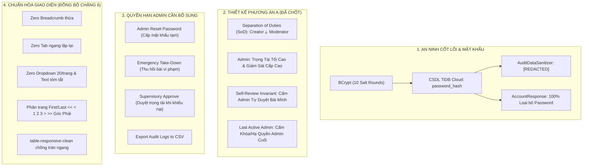

# ĐẶC TẢ KIẾN TRÚC & THIẾT KẾ TOÀN DIỆN CHẶNG 7 (QUẢN TRỊ HỆ THỐNG - ADMIN)
**Tài liệu thiết kế kỹ thuật, ranh giới an ninh và kế hoạch triển khai dành cho Coding Agent**

---

## 1. TỔNG QUAN & BỐI CẢNH DỰ ÁN

Tài liệu này ghi nhận toàn bộ quyết nghị thiết kế, kiến trúc an ninh và ranh giới quyền hạn cho **Chặng 7: Quản Trị Hệ Thống & Bảo Mật (Admin)** thuộc hệ thống WebLearnChinese. 

Tài liệu được soạn thảo nhằm chuyển giao ngữ cảnh hoàn chỉnh, rành mạch cho Agent kế thừa tiếp nhận và thực thi ngay lập tức mà không bị đứt gãy thông tin khi ngữ cảnh hội thoại dài.



---

## 2. KIẾN TRÚC BẢO VỆ MẬT KHẨU & AN TOÀN THÔNG TIN (PASSWORD SECURITY)

### 2.1. Thuật Toán Băm Mật Khẩu (BCrypt 10 Salt Rounds)
- **Hàm băm**: Hệ thống sử dụng `BCryptPasswordEncoder` được cấu hình tại `backend/src/main/java/com/elearning/config/SecurityConfig.java`:
  ```java
  @Bean
  public PasswordEncoder passwordEncoder() {
      return new BCryptPasswordEncoder(); // Mặc định 10 salt rounds (1.024 chu kỳ băm)
  }
  ```
- **Kháng tấn công**: BCrypt tích hợp muối ngẫu nhiên (salt) 128-bit độc bản cho mỗi mật khẩu, kháng triệt để tấn công vét cạn (Brute-force) và bảng băm sẵn (Rainbow Table) trên phần cứng chuyên dụng GPU/ASIC.
- **Chuỗi băm thực tế**: Mỗi mật khẩu sau khi băm có dạng `$2a$10$...` dài 60 ký tự.

### 2.2. Vòng Đời Mật Khẩu
1. **Đăng ký (`AuthServiceImpl.java#register`)**:
   `account.setPasswordHash(passwordEncoder.encode(request.getPassword()));`
   Mật khẩu thô được băm trước khi ghi vào CSDL.
2. **Đăng nhập (`AuthServiceImpl.java#login`)**:
   `authenticationManager.authenticate(...)` sử dụng `CustomUserDetailsService` và `passwordEncoder.matches(rawPassword, passwordHash)` để so khớp, không bao giờ giải mã ngược chuỗi hash.
3. **Đổi mật khẩu (`AuthServiceImpl.java#changePassword`)**:
   - So khớp mật khẩu cũ: `passwordEncoder.matches(request.getOldPassword(), account.getPasswordHash())`.
   - Chặn đặt trùng: `passwordEncoder.matches(request.getNewPassword(), account.getPasswordHash())`.
   - Băm mật khẩu mới: `account.setPasswordHash(passwordEncoder.encode(request.getNewPassword()))`.
   - Tự động hủy phiên cũ: `account.incrementAuthorizationVersion();` làm mất hiệu lực toàn bộ JWT tokens hiện hữu trên mọi thiết bị.

### 2.3. Rào Chắn Chống Rò Rỉ Mật Khẩu
- **CSDL TiDB Cloud (`V1__init_schema.sql`)**: Cột lưu trữ là `password_hash VARCHAR(255) NOT NULL`. CSDL không bao giờ lưu trữ mật khẩu rõ (Zero Plain-text).
- **DTO Khử Trừ (`AccountResponse.java`)**: DTO trả về danh sách tài khoản cho Admin tuyệt đối không chứa trường `password` hay `passwordHash`.
- **Nhật Ký Kiểm Toán (`AuditDataSanitizer.java`)**: Mọi payload được ghi log qua `management_audit_log` đều chạy qua regex `(?i).*(password|token|jwt|secret|hash|bearer|authorization).*` và được thay thế bằng chuỗi `[REDACTED]`.

---

## 3. BẢN THIẾT KẾ PHƯƠNG ÁN A (QUYẾT NGHỊ ĐÃ CHỐT)

Hệ thống tuân thủ nghiêm ngặt **Phương án A (Chuẩn Phân Lập Trách Nhiệm & Trọng Tài Tối Cao)**:

### 3.1. Bất Biến Phân Lập Trách Nhiệm Tuyệt Đối (Separation of Duties - SoD Invariant)
- **`Creator` (Tác giả)** và **`Moderator` (Kiểm duyệt viên)** là hai vai trò **loại trừ lẫn nhau tuyệt đối (Mutually Exclusive)**.
- Không một tài khoản nào trong hệ thống được phép đồng thời giữ cả hai quyền `Creator` và `Moderator`.
- **Ràng buộc UI (`admin-roles.html`)**: Khi tick `Creator`, checkbox `Moderator` tự động bị uncheck và disabled; khi tick `Moderator`, checkbox `Creator` tự động bị uncheck và disabled.
- **Ràng buộc Backend (`AdminRoleServiceImpl.java` & `demo-fallback-engine.js`)**: Kiểm tra nếu danh sách vai trò chứa cả `Creator` và `Moderator` thì lập tức ném lỗi `HTTP 400 Bad Request: "Vai trò Tác giả (Creator) và Kiểm duyệt viên (Moderator) loại trừ lẫn nhau tuyệt đối. Một tài khoản không thể đồng thời giữ cả hai vai trò."`

### 3.2. Vai Trò Trọng Tài Tối Cao của Admin (Admin Supervisory Authority)
- `Admin` là người có quyền hạn hệ thống cao nhất, đóng vai trò **Trọng tài Tối cao & Giám sát Cấp cao**.
- Quy trình bài học vận hành tự nhiên giữa 2 mắt xích: `Creator biên soạn` $\rightarrow$ `Moderator thẩm định`.
- **Admin KHÔNG "vừa tự tạo bài học vừa tự duyệt bài của mình"**: Tuân thủ tuyệt đối **Bất biến Cấm tự phê duyệt (Self-Review Invariant)**.
- Admin chỉ can thiệp vào bài học khi:
  1. *Có sự cố khẩn cấp về an ninh nội dung*: Bài học đã xuất bản bị phát hiện có nội dung độc hại, xuyên tạc, bản quyền $\rightarrow$ Admin thu hồi khẩn cấp qua `admin-lessons.html`.
  2. *Có tranh chấp / khiếu nại*: Tác giả khiếu nại bài bị từ chối oan hoặc bị kẹt duyệt $\rightarrow$ Admin vào phê duyệt trọng tài (kèm lý do phân giải).

### 3.3. Bảo Vệ Quản Trị Viên Cuối Cùng (Last Active Admin Invariant)
- Hệ thống ngăn chặn việc hạ quyền hoặc khóa tài khoản Admin hoạt động duy nhất còn lại trong hệ thống (`countActiveAdmins() <= 1`).
- Admin không thể tự khóa chính mình hoặc tự tước quyền Admin của chính mình (`POL-8D-02`).

### 3.4. Cô Lập Vòng Đời Phiên Quản Lý (`sessionStorage`)
- Token quản trị của Admin, Creator, Moderator được lưu độc quyền vào `sessionStorage`, tự động tiêu hủy 100% khi đóng tab Chrome.
- Cơ chế `enforceRoleWorkspaceGuard()` chặn đứng tài khoản quản trị đi vào trang học viên. Lối thoát duy nhất là bấm **Đăng xuất (Logout)**.

---

## 4. CÁC QUYỀN HẠN CỐT LÕI ADMIN ĐANG THIẾU & CẦN BỔ SUNG TRONG CHẶNG 7

Qua rà soát chuyên sâu mã nguồn, Admin hiện tại đang thiếu 5 quyền hạn và chức năng quan trọng sau:

### 4.1. Thiếu Sót 1: Đặt Lại Mật Khẩu Cho Người Dùng (Admin Password Reset)
- **Vấn đề**: Trang đăng nhập `login.html` có Modal "Quên mật khẩu?" ghi rõ: *"Nếu bạn quên mật khẩu, vui lòng liên hệ ban quản trị để được hỗ trợ đặt lại mật khẩu an toàn: Email: admin@weblearnchinese.com"*. Tuy nhiên trên `admin-accounts.html` và `AdminAccountController.java`, Admin lại **không có nút hay API nào để đặt lại mật khẩu cho người dùng**!
- **Giải pháp thiết kế**:
  * **Backend Endpoint**: `POST /api/v1/admin/accounts/{id}/reset-password`
  * **Payload Request**:
    ```json
    {
      "temporaryPassword": "Password@123" // Tùy chọn, nếu rỗng server tự sinh 10 ký tự ngẫu nhiên an toàn
    }
    ```
  * **Xử lý Service**: Băm mật khẩu bằng `passwordEncoder.encode(...)`, cập nhật `account.setPasswordHash(...)`, tăng `account.incrementAuthorizationVersion()` để hủy toàn bộ phiên cũ, ghi audit log với hành động `PASSWORD_RESET`.
  * **Frontend UI (`admin-accounts.html`)**: Thêm nút `"Đặt lại mật khẩu"` (icon chìa khóa 🔑) trên từng dòng bảng tài khoản, mở modal xác nhận an toàn, hiển thị mật khẩu tạm thời mới tạo để Admin gửi cho học viên.

### 4.2. Thiếu Sót 2: Thu Hồi / Gỡ Bài Học Vi Phạm Khẩn Cấp (Emergency Lesson Take-Down)
- **Vấn đề**: `AdminLessonController.java` hiện tại là **100% READ-ONLY** (chỉ có `GET /lessons` và `GET /lessons/{id}`). Nếu một bài học đã xuất bản (`Approved`) có nội dung vi phạm bản quyền hoặc độc hại, Admin không có cách nào gỡ bài trên giao diện.
- **Giải pháp thiết kế**:
  * **Backend Endpoint**: `POST /api/v1/admin/lessons/{id}/revoke` (hoặc `/suspend`)
  * **Payload Request**:
    ```json
    {
      "reason": "Vi phạm bản quyền giáo trình / chứa nội dung không phù hợp"
    }
    ```
  * **Xử lý Service**: Chuyển trạng thái bài học từ `Approved` về `Rejected`, lưu `rejectionReason`, bài học lập tức biến mất khỏi danh mục học viên (`lessons.html`), ghi audit log `LESSON_REVOKED`.
  * **Frontend UI (`admin-lessons.html`)**: Thêm nút `"Thu hồi xuất bản"` trên modal chi tiết của bài học đang ở trạng thái `Approved`.

### 4.3. Thiếu Sót 3: Phê Duyệt Trọng Tài Khi Có Tranh Chấp (Supervisory Arbiter Approval)
- **Vấn đề**: Khi tác giả khiếu nại bài bị kiểm duyệt viên từ chối oan hoặc bị ngâm duyệt quá hạn, Admin cần quyền phê duyệt trọng tài.
- **Giải pháp thiết kế**:
  * **Backend Endpoint**: `POST /api/v1/admin/lessons/{id}/approve`
  * **Ràng buộc an ninh bắt buộc**: Kiểm tra `Self-Review Invariant`: Nếu Admin chính là tác giả tạo bài (`currentAdminId == lesson.getCreatorId()`), ném lỗi `HTTP 403 Forbidden: "Admin không thể tự phê duyệt bài học do chính mình tạo ra"`.
  * **Frontend UI (`admin-lessons.html`)**: Thêm nút `"Phê duyệt trọng tài"` trên modal bài học `Pending` hoặc `Rejected`, kèm cảnh báo tự kiểm duyệt nếu Admin là tác giả.

### 4.4. Thiếu Sót 4: Khóa Cứng Bất Biến Creator ⟂ Moderator Phía Phân Quyền
- **Frontend (`admin-roles.html` & `admin-roles-page.js`)**:
  * Bổ sung hàm toggle loại trừ:
    ```javascript
    function handleRoleExclusivity(roleName, isChecked) {
      if (roleName === 'Creator' && isChecked) {
        uncheckAndDisable('Moderator');
      } else if (roleName === 'Moderator' && isChecked) {
        uncheckAndDisable('Creator');
      }
    }
    ```
  * Cập nhật `validateRoleSelection()`: Trả về lỗi nếu cả 2 vai trò cùng xuất hiện.
- **Backend (`AdminRoleServiceImpl.java` & `demo-fallback-engine.js`)**:
  * Kiểm tra tập hợp vai trò, ném ngoại lệ nếu có cả `Creator` và `Moderator`.

### 4.5. Thiếu Sót 5: Xuất Báo Cáo Nhật Ký Kiểm Toán (Audit Logs CSV Export)
- **Frontend UI (`admin-audit-logs.html` & `admin-audit-logs-page.js`)**:
  * Bổ sung nút `"Xuất CSV"` trên thanh công cụ lọc.
  * Xuất toàn bộ dữ liệu nhật ký của trang/bộ lọc hiện tại ra định dạng CSV đạt chuẩn RFC 4180 (UTF-8 with BOM hiển thị tiếng Việt hoàn hảo trên Excel).

---

## 5. BẢN THIẾT KẾ CHUẨN HÓA GIAO DIỆN (UI/UX POLISH SPECIFICATION)

Cả 6 trang của Chặng 7 sẽ được làm sạch đồng loạt theo chuẩn mực đã nghiệm thu ở Chặng 6:

| Quy Chuẩn Giao Diện | Hiện Trạng Cũ Cần Xóa Bỏ | Quy Chuẩn Mới Chuẩn Hóa |
|---|---|---|
| **Breadcrumb đầu trang** | `<nav aria-label="breadcrumb">` ("Trung tâm quản lý / ...") | **Xóa bỏ hoàn toàn 100%**. Giao diện thoáng đãng, bắt đầu thẳng từ tiêu đề trang. |
| **Thanh Tab ngang bị lặp** | `<nav class="moderator-nav-tabs">` (lặp lại 5 mục sidebar) | **Xóa bỏ hoàn toàn 100%** trên `admin-accounts.html` và `admin-roles.html`. |
| **Huy hiệu rườm rà** | `#adminOversightBadge` ("Quản Trị Hệ Thống (Admin)") | **Xóa bỏ**, chỉ giữ lại badge đếm số lượng bản ghi kết quả. |
| **Dropdown kích thước trang** | `<select id="pageSizeSelect">` ("Hiển thị: 20/trang") | **Xóa bỏ hoàn toàn 100%** trên cả 5 trang Admin. |
| **Dòng tóm tắt phân trang** | `<div id="...PaginationSummary">` ("Hiển thị 1–20 trong...") | **Xóa bỏ hoàn toàn 100%**. |
| **Cấu trúc Phân trang** | `ul.pagination` căn giữa hoặc dạt 2 bên | **Chuẩn hóa First/Last `<< < 1 2 3 > >>`** bằng `.pagination-container.justify-content-end` và `.pagination-btn` góc dưới bên phải. |
| **Bố cục Bảng dữ liệu** | `.table-responsive` cũ gây tràn ngang | Thay bằng **`.table-responsive-clean` kèm `max-width: 100%;`** chống tràn ngang tuyệt đối trên màn hình laptop/tablet. |
| **Cache-Buster URL** | Query string cũ hoặc thiếu | Bổ sung đồng bộ **`?v=20261028_04`** trên toàn bộ CSS và JS. |

---

## 6. MA TRẬN TỆP MÃ NGUỒN CẦN TRIỂN KHAI

### 6.1. Nhóm Giao Diện Frontend (6 Trang Admin + 1 Trang Verification)
1. `frontend/admin-accounts.html` & `frontend/js/pages/admin-accounts-page.js`
2. `frontend/admin-roles.html` & `frontend/js/pages/admin-roles-page.js`
3. `frontend/admin-lessons.html` & `frontend/js/pages/admin-lessons-page.js`
4. `frontend/admin-vocabulary.html` & `frontend/js/pages/admin-vocabulary-page.js`
5. `frontend/admin-radicals.html` & `frontend/js/pages/admin-radicals-page.js`
6. `frontend/admin-audit-logs.html` & `frontend/js/pages/admin-audit-logs-page.js`
7. `frontend/ui-verification.html` & `frontend/js/pages/ui-verification-page.js`
8. `frontend/js/api/demo-fallback-engine.js` (Cập nhật logic reset password, SoD, revoke lesson)

### 6.2. Nhóm Backend Spring Boot
1. `backend/src/main/java/com/elearning/controller/AdminAccountController.java` & `AdminAccountServiceImpl.java` (Thêm API `resetPassword`)
2. `backend/src/main/java/com/elearning/dto/request/AdminResetPasswordRequest.java` (DTO mới)
3. `backend/src/main/java/com/elearning/controller/AdminLessonController.java` & `LessonServiceImpl.java` (Thêm API `revokeLesson` và `supervisoryApproveLesson`)
4. `backend/src/main/java/com/elearning/dto/request/AdminRevokeLessonRequest.java` (DTO mới)
5. `backend/src/main/java/com/elearning/service/impl/AdminRoleServiceImpl.java` (Khóa cứng SoD Invariant)

### 6.3. Nhóm Kiểm Thử (Unit Tests & Browser E2E Tests)
1. `tests/frontend/unit/admin/admin-accounts.test.mjs`
2. `tests/frontend/unit/admin/admin-roles.test.mjs`
3. `tests/frontend/unit/admin/admin-lessons.test.mjs`
4. `tests/frontend/unit/admin/admin-vocabulary.test.mjs`
5. `tests/frontend/unit/admin/admin-radicals.test.mjs`
6. `tests/frontend/unit/admin/admin-audit-logs.test.mjs`
7. `tests/frontend/e2e/admin-accounts.browser.mjs`
8. `tests/frontend/e2e/admin-roles.browser.mjs`
9. `tests/frontend/e2e/admin-lessons.browser.mjs`
10. `tests/frontend/e2e/admin-vocabulary.browser.mjs`
11. `tests/frontend/e2e/admin-radicals.browser.mjs`

---

## 7. BẢNG CHECKLIST NGHIỆM THU DÀNH CHO AGENT TIẾP THEO

- [ ] **Mật khẩu & Hash**: Đảm bảo toàn bộ thao tác reset password đều sử dụng `BCryptPasswordEncoder`, không bao giờ trả về mật khẩu thô trong response DTO, tự động hủy token JWT cũ qua `incrementAuthorizationVersion()`.
- [ ] **Phân lập Trách nhiệm (SoD)**: Xác minh modal `admin-roles.html` không thể tick đồng thời `Creator` và `Moderator`. Thử gửi request chứa cả 2 vai trò lên Backend phải nhận về `HTTP 400 Bad Request`.
- [ ] **Thu hồi Bài học Khẩn cấp**: Bài học `Approved` trên `admin-lessons.html` có nút thu hồi, chuyển về `Rejected` kèm lý do, lập tức ẩn khỏi `lessons.html`.
- [ ] **Phê duyệt Trọng tài**: Bài học `Pending`/`Rejected` có thể được Admin phê duyệt giải quyết khiếu nại, có chặn cứng cấm Admin tự duyệt bài của mình (`Self-Review Invariant`).
- [ ] **Tinh gọn Giao diện 6 Trang**:
  - Không còn bất kỳ dòng breadcrumb `Trung tâm quản lý / ...`.
  - Không còn thanh tab ngang lặp lại `<nav class="moderator-nav-tabs">`.
  - Không còn dropdown `Hiển thị: 20/trang` hay `#pageSizeSelect`.
  - Không còn nhãn tóm tắt phân trang bên trái.
  - Phân trang chuẩn First/Last `<< < 1 2 3 > >>` nằm ở góc dưới bên phải (`justify-content-end`).
  - Class `.table-responsive-clean` với `max-width: 100%` chống tràn ngang.
- [ ] **Bộ Lệnh Xác Minh Bắt Buộc**:
  - `npm run verify:frontend:fast` (100% PASS, tối thiểu 1.115+ tests).
  - `node tests/e2e/runner.mjs --tier=all` (100% PASS, 74/74 tests Tiers 1–4).
  - Browser tests: Chạy lần lượt các tệp `tests/frontend/e2e/admin-*.browser.mjs`.
  - Không có lỗi `document-level horizontal overflow` trên mọi viewport từ 360px đến 1920px.
